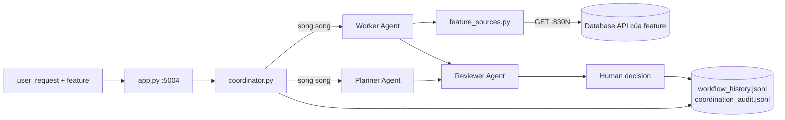

# Lab R2-1 - Multi-Agent Server dùng chung (Planner → Worker → Reviewer → Human)

**Course:** Advanced Software Development with Agentic AI (ASD 2026)  
**Project:** Digital Banking System - Group 44, Release 2  
**Theme:** Multi-Agent Coordination, Evidence, Review, and Human Oversight  
**Primary IDE:** VS Code  
**AI Agent Runtime:** Ollama (qwen2.5:0.5b, llama3.1:8b)  
**Duration:** 60 phút  
**Viết cho:** student-5 (Gia), làm lại từ nhánh `main` sạch  
**Dựa trên:** `asd-labs/Lab_10_Multi_Agent_Coordination.md`  
**Code server:** bản của Binh (nhánh `account_management`, commit `0052e67`), **giữ nguyên, không sửa**  

---

## 1. Overview

<details>
<summary>Goal</summary>

Thay Multi-Agent Server mẫu Lab 10 đang có trên `main` bằng **bản dùng chung của nhóm** (bản của Binh), để:

* Worker lấy **dữ liệu thật** của app ngân hàng qua database API của từng feature (cards, accounts, users, transactions), không còn đọc `enrolment.db` của Lab 10
* Con người **ghi được quyết định** (Accept / Partially Accept / Reject) qua API và qua terminal
* Kết quả có trạng thái trung thực: `completed` / `degraded` / `failed`

Lab này chỉ đụng thư mục `ai-services/multi-agent-server/`. Phần nối student-5 với server làm ở Lab R2-2.

</details>

<details>
<summary>Agentic Workflow</summary>



</details>

<details>
<summary>Expected Results</summary>

Hết lab này bạn có:

* Server chạy ở `http://localhost:5004`, `GET /` liệt kê 4 feature
* Một workflow chạy bằng `curl` và một workflow chạy bằng `workflow_runner.py`
* Một quyết định của con người được ghi vào log
* Một commit: `Multi-Agent Server: shared multi-feature version (Binh)`

Đây là phần lõi của **tiêu chí 2** (Multi-Agent Server and Workflow).

</details>

---

## 2. Prerequisites and Configuration

<details>
<summary>Prerequisites</summary>

* Đã làm Release 0 và Release 1 (app chạy được bằng `docker compose`)
* Docker Desktop đang chạy
* Python 3.11+ với `.venv` của repo
* Ollama đang chạy với `qwen2.5:0.5b` và `llama3.1:8b` (không có Ollama server vẫn chạy, nhưng mọi workflow sẽ ở trạng thái `degraded`)

</details>

<details>
<summary>Model Configuration</summary>

```env
OLLAMA_BASE_URL=http://localhost:11434/v1
OLLAMA_MODEL=qwen2.5:0.5b             # Planner, Worker
OLLAMA_REVIEW_MODEL=llama3.1:8b       # Reviewer
OLLAMA_REVIEW_FALLBACK_MODEL=qwen2.5:0.5b
OLLAMA_TIMEOUT_SECONDS=45             # mỗi lần gọi model
# Mỗi bước được chờ tối đa 2 × 45 + 10 = 100 giây (AGENT_STEP_TIMEOUT_SECONDS)
```

Không cần tạo file `.env`; đây là giá trị mặc định trong code.

</details>

<details>
<summary>Agent Roles</summary>

| Agent | Làm gì | Model | Trả về theo mẫu |
|---|---|---|---|
| Planner | Lập kế hoạch cho feature được chọn | qwen2.5:0.5b | Objective / Steps / Evidence Required / Human Approval |
| Worker | Lấy dữ liệu thật, trả lời chỉ dựa trên dữ liệu đó | qwen2.5:0.5b | Output / Evidence Used / Limitations |
| Reviewer | Soát kết quả của Worker | llama3.1:8b, dự phòng qwen2.5:0.5b | Risk / Correction / Retest / Recommendation |
| Human | Quyết định cuối | - | Accept / Partially Accept / Reject |

</details>

<details>
<summary>Feature Registry</summary>

| Feature | Chủ | Worker gọi |
|---|---|---|
| `cards` | student-1 | `GET http://localhost:8301/cards` |
| `accounts` | student-2 | `GET http://localhost:8302/accounts` |
| `users` | student-4 | `GET http://localhost:8304/users` |
| `transactions` | student-5 | `GET http://localhost:8305/transactions` |

Server chạy trên máy (không phải container), nên gọi database qua **cổng đã publish ra máy** (830N), giống MCP Server.

</details>

---

## 3. Scenario Setup

<details>
<summary>Scenario</summary>

Trên `main`, Worker của Multi-Agent Server vẫn là code mẫu Lab 10: nó đọc `ai-services/enrolment.db` (sinh viên môn ASD101). File đó không có trong repo, nên **mọi lần chạy đều có `evidence_count: 0`**, mà server vẫn báo `success`. Không có endpoint ghi quyết định, và `workflow_runner.py` gọi `run_workflow` sai số tham số.

Binh đã viết bản dùng chung giải quyết cả ba. Lab này đưa bản đó vào nhánh của bạn, **nguyên văn**.

</details>

<details>
<summary>Create Working Branch</summary>

Bắt đầu từ `main` mới nhất, trên một **nhánh mới**. Các nhánh cũ (`multi-agent-shared`, `student-5-release2`, `cloud-fix`) giữ nguyên làm bản sao lưu, không xóa.

```bash
cd ~/project-ASD
git status                         # phải sạch; nếu còn thay đổi thì commit hoặc stash trước
git fetch origin
git switch -c release2-gia origin/main
git log -1 --oneline               # c8b2d10 Merge branch 'card_management' (hoặc mới hơn)
```

Kiểm tra bạn đang đứng đúng chỗ:

```bash
ls ai-services/multi-agent-server/agents/
# __init__.py  planner_agent.py  reviewer_agent.py  worker_agent.py      <- chưa có feature_sources.py
```

</details>

<details>
<summary>Project Structure</summary>

```
ai-services/multi-agent-server/
├── app.py                     # sửa  - HTTP API
├── coordinator.py             # sửa  - điều phối, log, quyết định
├── workflow_runner.py         # sửa  - chạy từ terminal
├── requirements.txt           # sửa  - thêm python-dotenv
├── agents/
│   ├── __init__.py            # giữ nguyên (file rỗng)
│   ├── feature_sources.py     # MỚI - registry 4 feature, lọc, che dữ liệu
│   ├── planner_agent.py       # sửa
│   ├── worker_agent.py        # sửa
│   └── reviewer_agent.py      # sửa
├── prompts/                   # giữ nguyên (planner/worker/reviewer_prompt.txt)
├── workflow_history.jsonl     # giữ nguyên, server tự ghi thêm
└── coordination_audit.jsonl   # giữ nguyên, server tự ghi thêm
```

Hai file log đã có các bản ghi cũ từ bản mẫu. Bản mới đọc được chúng (đã thử), nên **không cần xóa**.

</details>

---

## 4. Application Setup and Development

Mở từng file trong VS Code, **chọn tất cả (Cmd+A) rồi dán đè** bằng nội dung bên dưới.

<details>
<summary>Multi-Agent Server Bootstrap</summary>

Thư viện server cần. So với `main` chỉ thêm `python-dotenv`.

</details>

<details>
<summary>ai-services/multi-agent-server/requirements.txt</summary>

```text
flask==3.0.3
flask-cors==4.0.1
openai
python-dotenv
requests
```

Cài vào `.venv` của repo:

```bash
.venv/bin/python -m pip install -r ai-services/multi-agent-server/requirements.txt
```

</details>

<details>
<summary>Agent Prompts (giữ nguyên)</summary>

Ba file prompt trong `ai-services/multi-agent-server/prompts/` **không đổi**. Kiểm tra nhanh cho chắc:

```bash
git diff origin/account_management -- ai-services/multi-agent-server/prompts/      # không in ra gì = giống hệt bản của Binh
```

</details>

<details>
<summary>Agent Implementation</summary>

Bốn file trong `agents/`. Đọc `feature_sources.py` trước, vì Worker và Planner dùng nó.

</details>

<details>
<summary>ai-services/multi-agent-server/agents/feature_sources.py</summary>

```python
"""Where the Multi-Agent workflow gets its evidence from.

Same rule as mcp-server/tools.py: the workflow never opens another feature's
.db file. The Worker Agent reads evidence through that feature's database API
over HTTP. The Multi-Agent Server runs on the host (not in Docker), so it calls
each database container on its published host port (830N).
"""

import os
import re
from typing import Any, Dict, List, Optional

import requests


FEATURES: Dict[str, Dict[str, Any]] = {
    "cards": {
        "label": "Card Management",
        "owner": "student-1",
        "base_url": os.getenv("STUDENT1_DB_URL", "http://localhost:8301"),
        "path": "/cards",
        "items_key": None,
    },
    "accounts": {
        "label": "Bank Account Management",
        "owner": "student-2",
        "base_url": os.getenv("STUDENT2_DB_URL", "http://localhost:8302"),
        "path": "/accounts",
        "items_key": None,
    },
    "users": {
        "label": "User Management",
        "owner": "student-4",
        "base_url": os.getenv("STUDENT4_DB_URL", "http://localhost:8304"),
        "path": "/users",
        "items_key": None,
    },
    "transactions": {
        "label": "Transaction Management",
        "owner": "student-5",
        "base_url": os.getenv("STUDENT5_DB_URL", "http://localhost:8305"),
        "path": "/transactions",
        # student-5 wraps its rows: {"count": n, "transactions": [...]}
        "items_key": "transactions",
    },
}

# Checked in this order, so "card status for user_id 1" is about cards, not users,
# and "transactions for account_id 3" is about transactions, not accounts.
FEATURE_KEYWORDS = (
    ("cards", r"\bcards?\b"),
    ("transactions", r"\btransactions?\b"),
    ("accounts", r"\baccounts?\b"),
    ("users", r"\busers?\b"),
)

# "user_id(1)", "user id 1", "account_id: 3", "card-id 2"
ID_PATTERN = re.compile(r"\b(user|account|card|transaction)[\s_-]?id\W{0,3}(\d+)", re.IGNORECASE)

# Evidence is sent to the models and written to workflow_history.jsonl,
# so secrets are dropped and identifiers are masked before either happens.
DROP_FIELDS = {"password", "password_hash", "cvv", "pin"}
MASK_FIELDS = {"card_number", "account_number", "phone"}

MAX_EVIDENCE_RECORDS = int(os.getenv("MAX_EVIDENCE_RECORDS", "20"))
REQUEST_TIMEOUT_SECONDS = 5


class EvidenceError(Exception):
    """The feature's database API could not supply evidence."""


def supported_features() -> List[str]:
    return sorted(FEATURES)


def resolve_feature(
    feature: Optional[str],
    caller: Optional[str],
    user_request: str
) -> str:
    """Pick the feature: explicit value, then the caller's feature, then keywords.

    Raises ValueError when an explicit feature is unknown or nothing matches.
    """
    explicit = (feature or "").strip().lower()
    if explicit:
        if explicit in FEATURES:
            return explicit
        for key, source in FEATURES.items():
            if explicit == source["owner"]:
                return key
        raise ValueError(
            f"Unknown feature {feature!r}. Choose one of: {', '.join(supported_features())}"
        )

    caller_key = (caller or "").strip().lower()
    for key, source in FEATURES.items():
        if caller_key == source["owner"]:
            return key

    for key, pattern in FEATURE_KEYWORDS:
        if re.search(pattern, user_request, re.IGNORECASE):
            return key

    raise ValueError(
        "feature is required and could not be inferred from the request. "
        f"Choose one of: {', '.join(supported_features())}"
    )


def describe_source(feature: str) -> str:
    source = FEATURES[feature]
    return (
        f"{source['label']} database API "
        f"(GET {source['base_url']}{source['path']})"
    )


def extract_id_filters(user_request: str) -> Dict[str, str]:
    return {
        f"{name.lower()}_id": value
        for name, value in ID_PATTERN.findall(user_request)
    }


def _mask(value: Any) -> str:
    text = str(value)
    return "****" + text[-4:] if len(text) > 4 else "****"


def _mask_email(value: Any) -> str:
    local, _, domain = str(value).partition("@")
    return f"{local[:1]}***@{domain}" if domain else "****"


def redact(record: Dict[str, Any]) -> Dict[str, Any]:
    clean = {}
    for key, value in record.items():
        if key in DROP_FIELDS:
            continue
        if value is not None and key in MASK_FIELDS:
            clean[key] = _mask(value)
        elif value is not None and key == "email":
            clean[key] = _mask_email(value)
        else:
            clean[key] = value
    return clean


def _matching_fields(record: Dict[str, Any], field: str) -> List[str]:
    # account_id also matches sender_account_id / receiver_account_id
    return [key for key in record if key == field or key.endswith("_" + field)]


def apply_filters(
    records: List[Dict[str, Any]],
    filters: Dict[str, str]
) -> tuple[List[Dict[str, Any]], Dict[str, str], Dict[str, str]]:
    """Keep the records matching every applicable id filter.

    A filter is applicable when the feature's records carry that field.
    Returns (matching records, filters applied, filters ignored).
    """
    applied, ignored = {}, {}
    for field, value in filters.items():
        if any(_matching_fields(record, field) for record in records):
            applied[field] = value
        else:
            ignored[field] = value

    matching = [
        record for record in records
        if all(
            any(str(record[key]) == value for key in _matching_fields(record, field))
            for field, value in applied.items()
        )
    ]
    return matching, applied, ignored


def _fetch_records(feature: str) -> List[Dict[str, Any]]:
    source = FEATURES[feature]
    url = f"{source['base_url']}{source['path']}"

    try:
        response = requests.get(url, timeout=REQUEST_TIMEOUT_SECONDS)
        response.raise_for_status()
        data = response.json()
    except requests.exceptions.ConnectionError as exc:
        raise EvidenceError(
            f"Database API unreachable at {source['base_url']}. Is the container running?"
        ) from exc
    except requests.exceptions.Timeout as exc:
        raise EvidenceError(
            f"Database API at {source['base_url']} did not respond in {REQUEST_TIMEOUT_SECONDS}s"
        ) from exc
    except requests.exceptions.HTTPError as exc:
        raise EvidenceError(f"Database API returned {response.status_code} for {url}") from exc
    except ValueError as exc:
        raise EvidenceError(f"Database API at {url} sent a non-JSON reply") from exc

    if source["items_key"] and isinstance(data, dict):
        data = data.get(source["items_key"], [])
    if not isinstance(data, list):
        raise EvidenceError(f"Database API at {url} sent an unexpected reply")

    return [record for record in data if isinstance(record, dict)]


def fetch_evidence(
    feature: str,
    user_request: str
) -> Dict[str, Any]:
    """Read the feature's records, narrow them to the ids named in the request,
    redact them, and cap how many are handed to the models.

    Raises EvidenceError when the database API cannot be read.
    """
    records = _fetch_records(feature)
    matching, applied, ignored = apply_filters(
        records,
        extract_id_filters(user_request)
    )

    return {
        "source": describe_source(feature),
        "total_records": len(records),
        "matched_records": len(matching),
        "filters_applied": applied,
        "filters_ignored": ignored,
        "records": [redact(record) for record in matching[:MAX_EVIDENCE_RECORDS]],
    }
```

**Giải thích:**

* `FEATURES`: bản đồ 4 feature → database API. Có thể đổi địa chỉ bằng biến `STUDENT{N}_DB_URL`.
* `resolve_feature(feature, caller, user_request)`: chọn feature theo thứ tự `feature` → `caller` (vd `student-5` → `transactions`) → từ khóa trong câu hỏi → nếu không được thì `ValueError` (server trả 400).
* `ID_PATTERN` + `apply_filters`: câu hỏi phải có chữ **id**, vd `account_id 3`, `user id 1`. `account_id` khớp cả `sender_account_id` và `receiver_account_id`.
* `redact`: bỏ `password`, `password_hash`, `cvv`, `pin`; che `card_number`, `account_number`, `phone` thành `****1234`; che email. Làm **trước** khi gửi cho model và trước khi ghi log.
* `fetch_evidence`: gọi API, lọc, che, giới hạn `MAX_EVIDENCE_RECORDS` = 20. Lỗi kết nối → `EvidenceError` (Worker báo `error`, không bịa dữ liệu).

</details>

<details>
<summary>ai-services/multi-agent-server/agents/planner_agent.py</summary>

```python
import os
import sys
from pathlib import Path
from typing import Any, Dict, List, Optional

from openai import OpenAI

# Allows `python agents/planner_agent.py` as well as `from agents.planner_agent import ...`
if __package__ in (None, ""):
    sys.path.insert(0, str(Path(__file__).resolve().parents[1]))

from agents.feature_sources import FEATURES, describe_source


BASE_DIR = Path(__file__).resolve().parents[1]
PROMPT_PATH = BASE_DIR / "prompts" / "planner_prompt.txt"

OLLAMA_BASE_URL = os.getenv(
    "OLLAMA_BASE_URL",
    "http://localhost:11434/v1"
)

OLLAMA_MODEL = os.getenv(
    "OLLAMA_MODEL",
    "qwen2.5:0.5b"
)

OLLAMA_TIMEOUT_SECONDS = float(
    os.getenv("OLLAMA_TIMEOUT_SECONDS", "45")
)

FAST_MODE = os.getenv(
    "FAST_MODE",
    "true"
).lower() == "true"

PLANNER_MAX_TOKENS = int(
    os.getenv(
        "PLANNER_MAX_TOKENS",
        "120" if FAST_MODE else "300"
    )
)

# No silent retries: the coordinator's step timeout must cover a single call.
client = OpenAI(
    base_url=OLLAMA_BASE_URL,
    api_key="ollama",
    timeout=OLLAMA_TIMEOUT_SECONDS,
    max_retries=0
)


def load_prompt() -> str:
    return PROMPT_PATH.read_text(
        encoding="utf-8"
    ).strip()


def default_steps() -> List[Dict[str, Any]]:
    return [
        {
            "step": 1,
            "agent": "planner_agent",
            "action": "Create workflow plan"
        },
        {
            "step": 2,
            "agent": "worker_agent",
            "action": "Retrieve database evidence and generate output"
        },
        {
            "step": 3,
            "agent": "reviewer_agent",
            "action": "Review output for risk, correction, retest, and recommendation"
        },
        {
            "step": 4,
            "agent": "human_reviewer",
            "action": "Accept, partially accept, or reject"
        }
    ]


def describe_context(
    feature: Optional[str]
) -> str:
    if feature not in FEATURES:
        return "Feature: not specified\nEvidence Source: not specified"

    return (
        f"Feature: {FEATURES[feature]['label']} ({feature})\n"
        f"Evidence Source: {describe_source(feature)}"
    )


def call_model(
    user_request: str,
    feature: Optional[str] = None
) -> tuple[str, Optional[str]]:
    prompt = f"""
{load_prompt()}

Constraints:
- Keep output concise.
- Provide exactly 3 milestones.
- Keep response under 140 words.

Context:

{describe_context(feature)}

User Request:

{user_request}
"""

    try:
        response = client.chat.completions.create(
            model=OLLAMA_MODEL,
            messages=[
                {
                    "role": "user",
                    "content": prompt
                }
            ],
            temperature=0.1,
            max_tokens=PLANNER_MAX_TOKENS
        )

        return response.choices[0].message.content.strip(), None

    except Exception as exc:
        return (
            "Objective: Process the user request.\n"
            "Steps: Plan, work, review, human decision.\n"
            "Evidence Required: Records from the feature's database API.\n"
            "Human Approval: Required.\n"
            f"Fallback Reason: {exc}"
        ), str(exc)


def plan_workflow(
    user_request: str,
    feature: Optional[str] = None
) -> Dict[str, Any]:
    plan, model_error = call_model(
        user_request,
        feature
    )

    result = {
        "status": "fallback" if model_error else "success",
        "agent": "planner_agent",
        "model": OLLAMA_MODEL,
        "objective": user_request,
        "feature": feature,
        "plan": plan,
        "steps": default_steps(),
        "human_approval_required": True
    }
    if model_error:
        result["error"] = model_error

    return result


if __name__ == "__main__":
    import json

    result = plan_workflow(
        "Generate a card status summary for user_id(1).",
        "cards"
    )

    print(
        json.dumps(
            result,
            indent=2
        )
    )
```

**Giải thích:** Planner nhận thêm `feature` để kế hoạch nhắc đúng nguồn bằng chứng ("Transaction Management database API"). `default_steps()` là 4 bước cố định Planner → Worker → Reviewer → Human. Gọi model lỗi thì trả kế hoạch dự phòng với `status: "fallback"` thay vì làm sập server.

</details>

<details>
<summary>ai-services/multi-agent-server/agents/worker_agent.py</summary>

```python
import json
import os
import sys
from pathlib import Path
from typing import Any, Dict, Optional

from openai import OpenAI

# Allows `python agents/worker_agent.py` as well as `from agents.worker_agent import ...`
if __package__ in (None, ""):
    sys.path.insert(0, str(Path(__file__).resolve().parents[1]))

from agents.feature_sources import (
    FEATURES,
    EvidenceError,
    describe_source,
    fetch_evidence,
    resolve_feature,
)


BASE_DIR = Path(__file__).resolve().parents[1]
PROMPT_PATH = BASE_DIR / "prompts" / "worker_prompt.txt"

OLLAMA_BASE_URL = os.getenv(
    "OLLAMA_BASE_URL",
    "http://localhost:11434/v1"
)

OLLAMA_MODEL = os.getenv(
    "OLLAMA_MODEL",
    "qwen2.5:0.5b"
)

OLLAMA_TIMEOUT_SECONDS = float(
    os.getenv("OLLAMA_TIMEOUT_SECONDS", "45")
)

FAST_MODE = os.getenv(
    "FAST_MODE",
    "true"
).lower() == "true"

WORKER_MAX_TOKENS = int(
    os.getenv(
        "WORKER_MAX_TOKENS",
        "180" if FAST_MODE else "400"
    )
)

# No silent retries: the coordinator's step timeout must cover a single call.
client = OpenAI(
    base_url=OLLAMA_BASE_URL,
    api_key="ollama",
    timeout=OLLAMA_TIMEOUT_SECONDS,
    max_retries=0
)


def load_prompt() -> str:
    return PROMPT_PATH.read_text(
        encoding="utf-8"
    ).strip()


def format_evidence(
    evidence: Dict[str, Any]
) -> str:
    records = evidence["records"]
    if not records:
        return f"No records found in {evidence['source']} for the requested filters."

    lines = [
        f"Source: {evidence['source']}",
        f"Records shown: {len(records)} of {evidence['matched_records']} matching "
        f"({evidence['total_records']} total)",
    ]
    if evidence["filters_applied"]:
        lines.append(f"Filters applied: {evidence['filters_applied']}")

    for record in records:
        lines.append(f"- {json.dumps(record)}")

    return "\n".join(lines)


def call_model(
    user_request: str,
    feature: str,
    evidence_text: str
) -> tuple[str, Optional[str]]:
    prompt = f"""
{load_prompt()}

Constraints:
- Use only the provided Feature Evidence.
- Do not invent records or fields.
- Return concise output under 180 words.

User Request:

{user_request}

Feature:

{FEATURES[feature]['label']} ({feature})

Feature Evidence:

{evidence_text}
"""

    try:
        response = client.chat.completions.create(
            model=OLLAMA_MODEL,
            messages=[
                {
                    "role": "user",
                    "content": prompt
                }
            ],
            temperature=0.1,
            max_tokens=WORKER_MAX_TOKENS
        )

        return response.choices[0].message.content.strip(), None

    except Exception as exc:
        return (
            "Output:\n"
            "Model output could not be generated.\n\n"
            "Evidence Used:\n"
            f"{evidence_text}\n\n"
            "Limitations:\n"
            f"Model call failed. Human review required. Error: {exc}"
        ), str(exc)


def generate_output(
    user_request: str,
    feature: Optional[str] = None
) -> Dict[str, Any]:
    try:
        feature = resolve_feature(
            feature,
            None,
            user_request
        )
    except ValueError as exc:
        return {
            "status": "error",
            "agent": "worker_agent",
            "feature": feature,
            "evidence_count": 0,
            "evidence": [],
            "output": "No feature evidence source could be selected.",
            "error": str(exc),
            "human_approval_required": True
        }

    try:
        evidence = fetch_evidence(
            feature,
            user_request
        )
    except EvidenceError as exc:
        return {
            "status": "error",
            "agent": "worker_agent",
            "feature": feature,
            "evidence_source": describe_source(feature),
            "evidence_count": 0,
            "evidence": [],
            "output": "Database evidence could not be retrieved.",
            "error": str(exc),
            "human_approval_required": True
        }

    output, model_error = call_model(
        user_request,
        feature,
        format_evidence(evidence)
    )

    result = {
        "status": "fallback" if model_error else "success",
        "agent": "worker_agent",
        "model": OLLAMA_MODEL,
        "feature": feature,
        "evidence_source": evidence["source"],
        "evidence_count": len(evidence["records"]),
        "matched_records": evidence["matched_records"],
        "total_records": evidence["total_records"],
        "filters_applied": evidence["filters_applied"],
        "filters_ignored": evidence["filters_ignored"],
        "evidence": evidence["records"],
        "output": output,
        "human_approval_required": True
    }
    if model_error:
        result["error"] = model_error

    return result


if __name__ == "__main__":
    result = generate_output(
        "Generate a card status summary for user_id(1).",
        "cards"
    )

    print(
        json.dumps(
            result,
            indent=2
        )
    )
```

**Giải thích:** `generate_output(user_request, feature)`:

1. `resolve_feature` → không chọn được thì `status: "error"`
2. `fetch_evidence` → không lấy được dữ liệu thì `status: "error"`, `evidence_count: 0`
3. `format_evidence` biến bản ghi thành văn bản, rồi `call_model` dặn model **chỉ dùng bằng chứng**
4. Model lỗi → `status: "fallback"` (vẫn trả kèm bằng chứng để con người xem)

`max_retries=0`: không thử lại ngầm, để tổng thời gian nằm trong giới hạn của coordinator.

</details>

<details>
<summary>ai-services/multi-agent-server/agents/reviewer_agent.py</summary>

```python
import json
import os
from pathlib import Path
from typing import Any, Dict, Optional

from openai import OpenAI


BASE_DIR = Path(__file__).resolve().parents[1]
PROMPT_PATH = BASE_DIR / "prompts" / "reviewer_prompt.txt"

OLLAMA_BASE_URL = os.getenv(
    "OLLAMA_BASE_URL",
    "http://localhost:11434/v1"
)

OLLAMA_REVIEW_MODEL = os.getenv(
    "OLLAMA_REVIEW_MODEL",
    "llama3.1:8b"
)

# Used when the review model cannot run (e.g. llama3.1:8b out of memory),
# so the workflow still gets a review instead of a canned failure message.
OLLAMA_REVIEW_FALLBACK_MODEL = os.getenv(
    "OLLAMA_REVIEW_FALLBACK_MODEL",
    os.getenv("OLLAMA_MODEL", "qwen2.5:0.5b")
)

OLLAMA_TIMEOUT_SECONDS = float(
    os.getenv("OLLAMA_TIMEOUT_SECONDS", "45")
)

FAST_MODE = os.getenv(
    "FAST_MODE",
    "true"
).lower() == "true"

REVIEWER_MAX_TOKENS = int(
    os.getenv(
        "REVIEWER_MAX_TOKENS",
        "160" if FAST_MODE else "400"
    )
)

# No silent retries: the coordinator's step timeout must cover a single call.
client = OpenAI(
    base_url=OLLAMA_BASE_URL,
    api_key="ollama",
    timeout=OLLAMA_TIMEOUT_SECONDS,
    max_retries=0
)


def load_prompt() -> str:
    return PROMPT_PATH.read_text(
        encoding="utf-8"
    ).strip()


def build_prompt(
    user_request: str,
    worker_result: Dict[str, Any],
    plan: Optional[str]
) -> str:
    return f"""
{load_prompt()}

Constraints:
- Keep each section brief and actionable.
- Return only: Risk, Correction, Retest, Recommendation.
- Keep response under 160 words.

User Request:

{user_request}

Planner Plan:

{plan or "No plan was supplied."}

Worker Result:

{json.dumps(worker_result, indent=2)}
"""


def call_model(
    model: str,
    prompt: str
) -> str:
    response = client.chat.completions.create(
        model=model,
        messages=[
            {
                "role": "user",
                "content": prompt
            }
        ],
        temperature=0.1,
        max_tokens=REVIEWER_MAX_TOKENS
    )

    return response.choices[0].message.content.strip()


def review_output(
    user_request: str,
    worker_result: Dict[str, Any],
    plan: Optional[str] = None
) -> Dict[str, Any]:
    prompt = build_prompt(
        user_request,
        worker_result,
        plan
    )

    try:
        return {
            "status": "success",
            "agent": "reviewer_agent",
            "model": OLLAMA_REVIEW_MODEL,
            "review": call_model(OLLAMA_REVIEW_MODEL, prompt),
            "human_approval_required": True
        }
    except Exception as exc:
        review_error = str(exc)

    if OLLAMA_REVIEW_FALLBACK_MODEL and OLLAMA_REVIEW_FALLBACK_MODEL != OLLAMA_REVIEW_MODEL:
        try:
            return {
                "status": "success",
                "agent": "reviewer_agent",
                "model": OLLAMA_REVIEW_FALLBACK_MODEL,
                "fallback_from": OLLAMA_REVIEW_MODEL,
                "fallback_reason": review_error,
                "review": call_model(OLLAMA_REVIEW_FALLBACK_MODEL, prompt),
                "human_approval_required": True
            }
        except Exception as exc:
            review_error = f"{review_error}; fallback {OLLAMA_REVIEW_FALLBACK_MODEL}: {exc}"

    return {
        "status": "fallback",
        "agent": "reviewer_agent",
        "model": OLLAMA_REVIEW_MODEL,
        "review": (
            "Risk: Review model unavailable.\n"
            "Correction: Verify Ollama and reviewer model.\n"
            "Retest: Run the workflow again.\n"
            "Recommendation: Do not approve until reviewed."
        ),
        "error": review_error,
        "human_approval_required": True
    }


if __name__ == "__main__":
    sample_worker_result = {
        "status": "success",
        "feature": "cards",
        "evidence_count": 2,
        "evidence": [
            {"card_id": 1, "user_id": 1, "status": "Frozen"},
            {"card_id": 2, "user_id": 1, "status": "Unfrozen"}
        ],
        "output": "User 1 has 2 cards: 1 frozen and 1 unfrozen."
    }

    result = review_output(
        "Generate a card status summary for user_id(1).",
        sample_worker_result,
        "Objective: Summarise card statuses for user 1."
    )

    print(
        json.dumps(
            result,
            indent=2
        )
    )
```

**Giải thích:** Reviewer gửi cả kết quả Worker (JSON) cho `llama3.1:8b`. Nếu model này lỗi, nó **tự thử `OLLAMA_REVIEW_FALLBACK_MODEL`** (qwen) và ghi `fallback_from`, `fallback_reason`. Hai model đều lỗi → `status: "fallback"` với khuyến nghị "không duyệt cho tới khi có review".

</details>

<details>
<summary>Coordination</summary>

Ba file điều phối: quản đốc, lễ tân HTTP, và lối vào terminal.

</details>

<details>
<summary>ai-services/multi-agent-server/coordinator.py</summary>

```python
import json
import os
import threading
import time
import uuid
from concurrent.futures import ThreadPoolExecutor
from concurrent.futures import TimeoutError as FutureTimeoutError
from datetime import datetime, timezone
from pathlib import Path
from typing import Any, Dict, Optional

from agents.feature_sources import resolve_feature
from agents.planner_agent import plan_workflow
from agents.worker_agent import generate_output
from agents.reviewer_agent import review_output


BASE_DIR = Path(__file__).resolve().parent

# Tests point this at a scratch folder so they do not touch the real evidence files.
DATA_DIR = Path(os.getenv("MULTI_AGENT_DATA_DIR", str(BASE_DIR)))
HISTORY_PATH = DATA_DIR / "workflow_history.jsonl"
AUDIT_PATH = DATA_DIR / "coordination_audit.jsonl"

# The reviewer may make two model calls (review model, then fallback model),
# so one step must outlast two model timeouts or the reviewer is always cut off.
OLLAMA_TIMEOUT_SECONDS = float(
    os.getenv("OLLAMA_TIMEOUT_SECONDS", "45")
)
AGENT_STEP_TIMEOUT_SECONDS = float(
    os.getenv("AGENT_STEP_TIMEOUT_SECONDS", str(2 * OLLAMA_TIMEOUT_SECONDS + 10))
)

HUMAN_DECISIONS = (
    "Accept",
    "Partially Accept",
    "Reject"
)

# Flask serves requests on several threads; appends and the
# "already decided?" check must not interleave.
_file_lock = threading.Lock()


class WorkflowNotFound(LookupError):
    pass


class DecisionAlreadyRecorded(Exception):
    pass


def now_iso() -> str:
    return datetime.now(
        timezone.utc
    ).isoformat()


def append_jsonl(
    path: Path,
    record: Dict[str, Any]
) -> None:
    path.parent.mkdir(parents=True, exist_ok=True)
    with path.open(
        "a",
        encoding="utf-8"
    ) as file:
        file.write(
            json.dumps(record) + "\n"
        )


def read_jsonl(
    path: Path
) -> list[Dict[str, Any]]:
    if not path.exists():
        return []

    records = []

    with path.open(
        "r",
        encoding="utf-8"
    ) as file:
        for line in file:
            if line.strip():
                records.append(
                    json.loads(line)
                )

    return records


def overall_status(
    planner_result: Dict[str, Any],
    worker_result: Dict[str, Any],
    reviewer_result: Dict[str, Any]
) -> str:
    """completed: every agent ran on its model and the worker had evidence.
    failed: the worker produced nothing usable (no evidence or timed out).
    degraded: anything in between (fallback text, timeout, zero records).
    """
    if worker_result.get("status") not in ("success", "fallback"):
        return "failed"

    if (
        planner_result.get("status") == "success"
        and worker_result.get("status") == "success"
        and reviewer_result.get("status") == "success"
        and worker_result.get("evidence_count", 0) > 0
    ):
        return "completed"

    return "degraded"


def run_workflow(
    user_request: str,
    feature: Optional[str] = None,
    caller: Optional[str] = None
) -> Dict[str, Any]:
    """Planner + Worker (in parallel) -> Reviewer (sees plan and worker output)
    -> pending human decision.

    Raises ValueError if no feature can be resolved for the request.
    """
    feature = resolve_feature(
        feature,
        caller,
        user_request
    )
    caller = (caller or "").strip() or "unknown"

    start_time = time.time()
    workflow_id = str(
        uuid.uuid4()
    )

    # Planner and worker do not depend on each other; run them concurrently.
    executor = ThreadPoolExecutor(max_workers=2)
    planner_future = executor.submit(
        plan_workflow,
        user_request,
        feature
    )
    worker_future = executor.submit(
        generate_output,
        user_request,
        feature
    )

    try:
        try:
            planner_result = planner_future.result(
                timeout=AGENT_STEP_TIMEOUT_SECONDS
            )
        except FutureTimeoutError:
            planner_future.cancel()
            planner_result = {
                "status": "timeout",
                "agent": "planner_agent",
                "plan": "Planner timed out. Continue with worker evidence and human review.",
                "human_approval_required": True
            }

        try:
            worker_result = worker_future.result(
                timeout=AGENT_STEP_TIMEOUT_SECONDS
            )
        except FutureTimeoutError:
            worker_future.cancel()
            worker_result = {
                "status": "timeout",
                "agent": "worker_agent",
                "feature": feature,
                "evidence_count": 0,
                "evidence": [],
                "output": "Worker timed out before generating output.",
                "human_approval_required": True
            }
    finally:
        # Do not wait for straggler model calls after timeout.
        executor.shutdown(wait=False, cancel_futures=True)

    # The reviewer checks the worker's output against the planner's plan.
    reviewer_executor = ThreadPoolExecutor(max_workers=1)
    reviewer_future = reviewer_executor.submit(
        review_output,
        user_request,
        worker_result,
        planner_result.get("plan")
    )

    try:
        try:
            reviewer_result = reviewer_future.result(
                timeout=AGENT_STEP_TIMEOUT_SECONDS
            )
        except FutureTimeoutError:
            reviewer_future.cancel()
            reviewer_result = {
                "status": "timeout",
                "agent": "reviewer_agent",
                "review": "Reviewer timed out. Human must decide based on available evidence.",
                "human_approval_required": True
            }
    finally:
        reviewer_executor.shutdown(wait=False, cancel_futures=True)

    duration_ms = int(
        (time.time() - start_time) * 1000
    )

    status = overall_status(
        planner_result,
        worker_result,
        reviewer_result
    )

    workflow_result = {
        "status": status,
        "workflow_id": workflow_id,
        "timestamp": now_iso(),
        "duration_ms": duration_ms,
        "user_request": user_request,
        "feature": feature,
        "caller": caller,
        "participating_agents": [
            "planner_agent",
            "worker_agent",
            "reviewer_agent"
        ],
        "planner_result": planner_result,
        "worker_result": worker_result,
        "reviewer_result": reviewer_result,
        "human_decision": {
            "required": True,
            "status": "pending",
            "allowed_values": list(HUMAN_DECISIONS),
            "submit_to": f"/workflow/{workflow_id}/decision"
        }
    }

    audit_record = {
        "event": "workflow_run",
        "workflow_id": workflow_id,
        "timestamp": workflow_result["timestamp"],
        "duration_ms": duration_ms,
        "status": status,
        "feature": feature,
        "caller": caller,
        "participating_agents": workflow_result["participating_agents"],
        "human_approval_required": True,
        "planner_status": planner_result.get("status"),
        "worker_status": worker_result.get("status"),
        "reviewer_status": reviewer_result.get("status"),
        "reviewer_model": reviewer_result.get("model"),
        "evidence_count": worker_result.get("evidence_count", 0)
    }

    with _file_lock:
        append_jsonl(
            HISTORY_PATH,
            workflow_result
        )

        append_jsonl(
            AUDIT_PATH,
            audit_record
        )

    return workflow_result


def _decisions_by_workflow(
    audit: list[Dict[str, Any]]
) -> Dict[str, Dict[str, Any]]:
    return {
        record["workflow_id"]: record
        for record in audit
        if record.get("event") == "human_decision"
    }


def record_decision(
    workflow_id: str,
    decision: str,
    reason: str,
    correction: str = "",
    reviewer: str = ""
) -> Dict[str, Any]:
    """Record the human's final call on a workflow, once.

    Raises ValueError (bad input), WorkflowNotFound, DecisionAlreadyRecorded.
    """
    matched = [
        value for value in HUMAN_DECISIONS
        if value.lower() == (decision or "").strip().lower()
    ]
    if not matched:
        raise ValueError(
            f"decision must be one of: {', '.join(HUMAN_DECISIONS)}"
        )
    decision = matched[0]

    reason = (reason or "").strip()
    correction = (correction or "").strip()
    if not reason:
        raise ValueError("reason is required")
    if decision == "Partially Accept" and not correction:
        raise ValueError("correction is required for Partially Accept")

    with _file_lock:
        workflow = next(
            (
                record for record in read_jsonl(HISTORY_PATH)
                if record.get("workflow_id") == workflow_id
            ),
            None
        )
        if workflow is None:
            raise WorkflowNotFound(f"Workflow not found: {workflow_id}")

        if workflow_id in _decisions_by_workflow(read_jsonl(AUDIT_PATH)):
            raise DecisionAlreadyRecorded(
                f"A human decision is already recorded for {workflow_id}"
            )

        decision_record = {
            "event": "human_decision",
            "workflow_id": workflow_id,
            "timestamp": now_iso(),
            "feature": workflow.get("feature"),
            "caller": workflow.get("caller"),
            "decision": decision,
            "reason": reason,
            "correction": correction,
            "reviewer": (reviewer or "").strip() or "unknown",
            "workflow_status": workflow.get("status")
        }

        append_jsonl(
            AUDIT_PATH,
            decision_record
        )

    return decision_record


def _summary(
    workflow: Dict[str, Any],
    decision: Optional[Dict[str, Any]]
) -> Dict[str, Any]:
    return {
        "workflow_id": workflow.get("workflow_id"),
        "timestamp": workflow.get("timestamp"),
        "feature": workflow.get("feature"),
        "caller": workflow.get("caller"),
        "status": workflow.get("status"),
        "planner_status": workflow.get("planner_result", {}).get("status"),
        "worker_status": workflow.get("worker_result", {}).get("status"),
        "reviewer_status": workflow.get("reviewer_result", {}).get("status"),
        "reviewer_model": workflow.get("reviewer_result", {}).get("model"),
        "evidence_count": workflow.get("worker_result", {}).get("evidence_count", 0),
        "human_decision": decision.get("decision") if decision else "pending"
    }


def workflow_status(
    feature: Optional[str] = None,
    caller: Optional[str] = None,
    recent: int = 5
) -> Dict[str, Any]:
    history = read_jsonl(
        HISTORY_PATH
    )

    audit = read_jsonl(
        AUDIT_PATH
    )

    decisions = _decisions_by_workflow(audit)

    selected = [
        record for record in history
        if (not feature or record.get("feature") == feature)
        and (not caller or record.get("caller") == caller)
    ]
    latest = selected[-1] if selected else None

    status_counts: Dict[str, int] = {}
    for record in selected:
        status_counts[record.get("status")] = status_counts.get(record.get("status"), 0) + 1

    return {
        "status": "success",
        "filter": {
            "feature": feature,
            "caller": caller
        },
        "workflow_history_count": len(history),
        "audit_record_count": len(audit),
        "matching_workflow_count": len(selected),
        "workflow_status_counts": status_counts,
        "human_decision_count": sum(
            1 for record in selected if record.get("workflow_id") in decisions
        ),
        "recent_workflows": [
            _summary(record, decisions.get(record.get("workflow_id")))
            for record in selected[-recent:]
        ],
        "latest_workflow": latest,
        "latest_human_decision": decisions.get(latest.get("workflow_id")) if latest else None
    }


if __name__ == "__main__":
    result = run_workflow(
        "Generate a card status summary for user_id(1).",
        "cards",
        "terminal"
    )

    print(
        json.dumps(
            result,
            indent=2
        )
    )
```

**Giải thích các phần chính:**

| Hàm | Vai trò |
|---|---|
| `run_workflow(user_request, feature, caller)` | Chọn feature (sai thì `ValueError` trước khi chạy agent nào), chạy Planner và Worker **song song** (`ThreadPoolExecutor(max_workers=2)`), rồi Reviewer. Mỗi bước có giới hạn `AGENT_STEP_TIMEOUT_SECONDS`; quá giờ thì điền kết quả `timeout` và đi tiếp |
| `overall_status` | `completed` khi cả 3 agent chạy đúng model chính và Worker có dữ liệu; `failed` khi Worker không có gì dùng được; còn lại `degraded` |
| `record_decision` | Luật: chỉ 3 giá trị; luôn cần `reason`; `Partially Accept` cần `correction`; mỗi workflow chỉ một quyết định (`DecisionAlreadyRecorded` → 409); không có workflow → `WorkflowNotFound` → 404 |
| `workflow_status(feature, caller)` | Đếm số lần chạy, theo trạng thái, quyết định gần nhất, lọc được theo feature/caller |

Hai file log chỉ **ghi thêm**, không sửa dòng cũ. `_file_lock` đảm bảo hai request cùng lúc không ghi lẫn nhau.

</details>

<details>
<summary>ai-services/multi-agent-server/app.py</summary>

```python
import os

from flask import Flask, jsonify, request
from flask_cors import CORS

from agents.feature_sources import supported_features
from coordinator import (
    DecisionAlreadyRecorded,
    WorkflowNotFound,
    record_decision,
    run_workflow,
    workflow_status,
)


app = Flask(__name__)
CORS(app)


@app.get("/")
def health():
    return jsonify(
        {
            "service": "multi-agent-server",
            "status": "running",
            "features": supported_features()
        }
    )


# Body: {"user_request": "...", "feature": "accounts", "caller": "student-2"}
# feature is optional when it can be inferred from caller or the request text.
@app.post("/workflow")
def workflow():
    data = request.get_json(
        silent=True
    ) or {}

    user_request = str(data.get(
        "user_request",
        ""
    )).strip()

    if not user_request:
        return jsonify(
            {
                "status": "error",
                "error": "user_request is required"
            }
        ), 400

    try:
        result = run_workflow(
            user_request,
            data.get("feature"),
            data.get("caller")
        )
    except ValueError as exc:
        return jsonify(
            {
                "status": "error",
                "error": str(exc),
                "features": supported_features()
            }
        ), 400

    return jsonify(
        result
    ), 200


# Body: {"decision": "Accept|Partially Accept|Reject", "reason": "...",
#        "correction": "...", "reviewer": "..."}
@app.post("/workflow/<workflow_id>/decision")
def decision(workflow_id):
    data = request.get_json(
        silent=True
    ) or {}

    try:
        record = record_decision(
            workflow_id,
            str(data.get("decision", "")),
            str(data.get("reason", "")),
            str(data.get("correction", "")),
            str(data.get("reviewer", ""))
        )
    except ValueError as exc:
        return jsonify({"status": "error", "error": str(exc)}), 400
    except WorkflowNotFound as exc:
        return jsonify({"status": "error", "error": str(exc)}), 404
    except DecisionAlreadyRecorded as exc:
        return jsonify({"status": "error", "error": str(exc)}), 409

    return jsonify(
        {
            "status": "success",
            "human_decision": record
        }
    ), 200


# Optional filters: ?feature=accounts&caller=student-2
@app.get("/workflow/status")
def status():
    return jsonify(
        workflow_status(
            request.args.get("feature"),
            request.args.get("caller")
        )
    ), 200


if __name__ == "__main__":
    app.run(
        # 0.0.0.0 so backend containers can reach it through host.docker.internal
        host="0.0.0.0",  # noqa: S104
        port=int(os.getenv("PORT", "5004")),
        debug=os.getenv("FLASK_DEBUG", "false").lower() == "true"
    )
```

**Giải thích - 4 endpoint:**

| Endpoint | Body / query | Trả về |
|---|---|---|
| `GET /` | - | `features`, `status: running` |
| `POST /workflow` | `{"user_request", "feature"?, "caller"?}` | toàn bộ bản ghi workflow (200), hoặc 400 |
| `POST /workflow/<id>/decision` | `{"decision", "reason", "correction"?, "reviewer"?}` | `human_decision` (200), hoặc 400/404/409 |
| `GET /workflow/status` | `?feature=&caller=` | thống kê |

</details>

<details>
<summary>ai-services/multi-agent-server/workflow_runner.py</summary>

```python
"""Run the Planner -> Worker -> Reviewer -> Human Review workflow from a terminal.

    python workflow_runner.py "Summarise account statuses for user_id(1)." --feature accounts
    python workflow_runner.py "..." --feature cards --decision Accept --reason "Matches evidence"
    python workflow_runner.py "..." --feature cards --no-decision

Without --decision, the human is asked for a decision when the terminal is interactive.
"""

import argparse
import json
import sys

from coordinator import (
    HUMAN_DECISIONS,
    DecisionAlreadyRecorded,
    WorkflowNotFound,
    record_decision,
    run_workflow,
)


DEFAULT_REQUEST = "Generate a card status summary for user_id(1)."


def parse_args() -> argparse.Namespace:
    parser = argparse.ArgumentParser(description=__doc__, formatter_class=argparse.RawDescriptionHelpFormatter)
    parser.add_argument("user_request", nargs="?", default=DEFAULT_REQUEST)
    parser.add_argument("--feature", help="cards, accounts, users or transactions (inferred if omitted)")
    parser.add_argument("--caller", default="terminal")
    parser.add_argument("--decision", help=" / ".join(HUMAN_DECISIONS))
    parser.add_argument("--reason", default="")
    parser.add_argument("--correction", default="")
    parser.add_argument("--reviewer", default="terminal")
    parser.add_argument("--no-decision", action="store_true", help="leave the decision pending")
    return parser.parse_args()


def ask_for_decision() -> tuple[str, str, str] | None:
    print()
    print("HUMAN REVIEW")
    for number, value in enumerate(HUMAN_DECISIONS, start=1):
        print(f"{number} - {value}")
    print("0 - Leave pending")

    choice = input("Decision: ").strip()
    if choice not in {"1", "2", "3"}:
        return None

    decision = HUMAN_DECISIONS[int(choice) - 1]
    reason = input("Reason: ").strip()
    correction = input("Correction (required for Partially Accept): ").strip()
    return decision, reason, correction


def main() -> int:
    args = parse_args()

    try:
        result = run_workflow(
            args.user_request,
            args.feature,
            args.caller
        )
    except ValueError as exc:
        print(f"Workflow not started: {exc}")
        return 2

    print(
        json.dumps(
            result,
            indent=2
        )
    )

    if args.no_decision:
        return 0

    if args.decision:
        answer = (args.decision, args.reason, args.correction)
    elif sys.stdin.isatty():
        answer = ask_for_decision()
    else:
        answer = None

    if answer is None:
        print(f"Human decision pending for {result['workflow_id']}")
        return 0

    try:
        record = record_decision(
            result["workflow_id"],
            *answer,
            reviewer=args.reviewer
        )
    except (ValueError, WorkflowNotFound, DecisionAlreadyRecorded) as exc:
        print(f"Decision not recorded: {exc}")
        return 2

    print(
        json.dumps(
            {"human_decision": record},
            indent=2
        )
    )
    return 0


if __name__ == "__main__":
    sys.exit(main())
```

**Giải thích:** chạy workflow **không cần HTTP**, gọi thẳng `run_workflow`, in kết quả, rồi hỏi quyết định (hoặc nhận qua `--decision`). Đây là phần "through the terminal" của tiêu chí 2.

</details>

---

## 5. Application Testing

<details>
<summary>Terminal A: Start the Databases</summary>

Worker cần database API của các feature đang chạy:

```bash
docker compose up -d
docker compose ps          # các container student*-db / *-database phải "running"
curl -s "http://localhost:8305/transactions?limit=1"     # student-5 DB trả JSON
```

</details>

<details>
<summary>Terminal B: Start the Multi-Agent Server</summary>

```bash
cd ai-services/multi-agent-server
python app.py
```

Mong đợi: ` * Running on http://127.0.0.1:5004`. Để terminal này chạy.

</details>

<details>
<summary>Terminal C: Test the API</summary>

**1. Health:**

```bash
curl -s localhost:5004/
```

```json
{"features":["accounts","cards","transactions","users"],"service":"multi-agent-server","status":"running"}
```

**2. Chạy một workflow cho student-5:**

```bash
curl -s -X POST localhost:5004/workflow -H 'Content-Type: application/json' \
  -d '{"user_request":"Review transactions for account_id 3","feature":"transactions","caller":"student-5"}' \
  -o /tmp/wf.json

python3 - <<'PY'
import json
d = json.load(open("/tmp/wf.json"))
w, r = d["worker_result"], d["reviewer_result"]
print("STATUS     :", d["status"], "| workflow_id:", d["workflow_id"])
print("WORKER     :", w["status"], "| model:", w.get("model"),
      "| evidence:", w["evidence_count"], "| filters:", w.get("filters_applied"))
print("\n--- Worker output ---\n" + w["output"])
print("\n--- Reviewer (" + r.get("model", "") + ", " + r["status"] + ") ---\n" + r["review"])
PY
```

Kết quả JSON rất dài, và Flask **sắp xếp khóa theo chữ cái** nên `worker_result` nằm cuối cùng; vì vậy lưu ra file rồi in tóm tắt. Xem toàn bộ: `python3 -m json.tool /tmp/wf.json | less` (bấm `q` để thoát).

Kiểm tra trong kết quả:

| Trường | Mong đợi |
|---|---|
| `status` | `completed` (có Ollama) hoặc `degraded` (không có Ollama) |
| `feature`, `caller` | `transactions`, `student-5` |
| `worker_result.filters_applied` | `{"account_id": "3"}` |
| `worker_result.evidence_count` | lớn hơn 0 (lúc thử: 3) |
| Worker output | 3 mục Output / Evidence Used / Limitations |
| Reviewer | 4 mục Risk / Correction / Retest / Recommendation, model `llama3.1:8b` |
| `human_decision.status` | `pending` |

Ghi lại `workflow_id`.

**3. Chọn feature tự động và báo lỗi:**

```bash
curl -s -X POST localhost:5004/workflow -H 'Content-Type: application/json' \
  -d '{"user_request":"Summarise recent activity","caller":"student-5"}' | grep -o '"feature": *"[a-z]*"'
# "feature": "transactions"   <- suy ra từ caller

curl -s -X POST localhost:5004/workflow -H 'Content-Type: application/json' \
  -d '{"user_request":"x","feature":"loans"}' -w "  HTTP %{http_code}\n"
# Unknown feature 'loans'. Choose one of: accounts, cards, transactions, users   HTTP 400
```

**4. Luật ghi quyết định** (thay `ID` bằng `workflow_id` ở bước 2):

```bash
ID=dán-workflow-id-vào-đây
d() { curl -s -X POST localhost:5004/workflow/$ID/decision -H 'Content-Type: application/json' -d "$1" -w "  HTTP %{http_code}\n"; }

d '{"decision":"Accept"}'                                   # reason is required                       HTTP 400
d '{"decision":"Partially Accept","reason":"r"}'            # correction is required for Partially Accept HTTP 400
d '{"decision":"Correct","reason":"r"}'                     # decision must be one of: ...              HTTP 400
d '{"decision":"Partially Accept","reason":"Totals right, wording vague","correction":"Use completed totals only","reviewer":"student-5"}'   # HTTP 200
d '{"decision":"Accept","reason":"again"}'                  # A human decision is already recorded      HTTP 409
```

**5. Status theo feature:**

```bash
curl -s "localhost:5004/workflow/status?feature=transactions" | python3 -m json.tool | head -20
# human_decision_count: 1, latest_human_decision.decision: "Partially Accept"
```

</details>

<details>
<summary>Terminal Testing (workflow_runner.py)</summary>

```bash
cd ai-services/multi-agent-server
python workflow_runner.py "Review transactions for account_id 2" --feature transactions
```

Chạy xong, script in kết quả rồi **hỏi quyết định** ngay trong terminal. Chạy không cần hỏi:

```bash
python workflow_runner.py "Review transactions for account_id 2" --feature transactions \
  --decision Accept --reason "Matches the evidence"
```

Mong đợi cuối output:

```json
"human_decision": {
    "event": "human_decision",
    "feature": "transactions",
    "caller": "terminal",
    "decision": "Accept",
    ...
}
```

Chụp màn hình terminal này làm bằng chứng tiêu chí 2.

</details>

<details>
<summary>Check the Logs</summary>

```bash
tail -n 2 ai-services/multi-agent-server/workflow_history.jsonl | cut -c1-300
tail -n 4 ai-services/multi-agent-server/coordination_audit.jsonl
```

`coordination_audit.jsonl` phải có cả dòng `"event": "workflow_run"` lẫn `"event": "human_decision"`.

</details>

---

## 6. Checkpoint and Commit

<details>
<summary>Checkpoint</summary>

- [ ] `GET /` liệt kê 4 feature
- [ ] Workflow `transactions` có `evidence_count > 0` và `filters_applied`
- [ ] 5 lệnh quyết định ra đúng 400 / 400 / 400 / 200 / 409
- [ ] `workflow_runner.py` chạy được và ghi quyết định
- [ ] Hai file log có dòng mới

</details>

<details>
<summary>Commit</summary>

```bash
git add ai-services/multi-agent-server
git status            # chỉ thấy file trong ai-services/multi-agent-server/
git commit -m "Multi-Agent Server: shared multi-feature version (Binh)"
```

Chưa cần push; push một lần ở cuối Lab R2-3.

**Lưu ý cho nhóm:** commit này đưa code của Binh vào nhánh của bạn. Khi PR được merge vào `main`, server của Binh có trên `main` luôn. Báo Binh để anh ấy không merge lại lần nữa (sẽ trùng nhưng không xung đột vì nội dung giống hệt).

</details>
