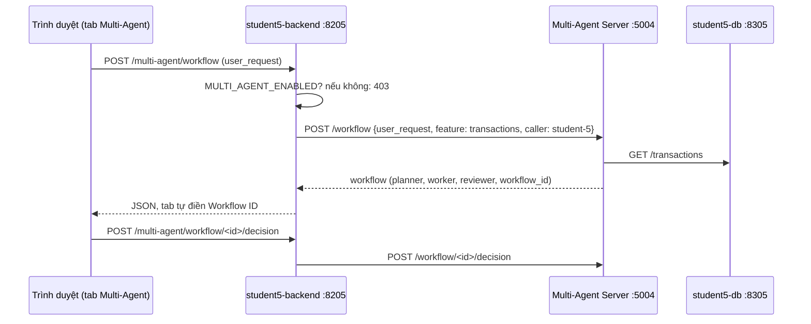

# Lab R2-2 - Nối student-5 với Multi-Agent Server

**Course:** Advanced Software Development with Agentic AI (ASD 2026)  
**Project:** Digital Banking System - Group 44, Release 2  
**Theme:** Backend Integration and Multi-Agent UI Mode  
**Primary IDE:** VS Code  
**AI Agent Runtime:** Ollama (qwen2.5:0.5b, llama3.1:8b)  
**Duration:** 45 phút  
**Viết cho:** student-5 (Gia), làm lại từ nhánh `main` sạch  
**Dựa trên:** `asd-labs/Lab_10_Multi_Agent_Coordination.md` (UI Integration, Backend Integration)  
**Làm sau:** Lab R2-1  

---

## 1. Overview

<details>
<summary>Goal</summary>

Thêm tab **Multi-Agent** vào trang Transactions của student-5:

* Người dùng gõ yêu cầu, bấm Run Workflow, xem kết quả của 3 agent
* Người dùng ghi quyết định Accept / Partially Accept / Reject
* Backend student-5 làm **proxy**: thêm `feature: transactions` và `caller: student-5`, gửi tới server ở cổng 5004
* Có công tắc `MULTI_AGENT_ENABLED`: tắt thì mọi route trả **403** (bắt buộc trên CI và cloud)

Cùng khuôn với tab RAG đã có (`rag_api.py` + `rag_mode.py` + `rag-mode.html`).

</details>

<details>
<summary>Request Flow</summary>



</details>

<details>
<summary>Expected Results</summary>

* Tab Multi-Agent hiện trong http://localhost:8105
* Một workflow chạy từ UI, một quyết định ghi từ UI
* `403` khi tắt công tắc
* 94 unit test cũ vẫn pass
* Một commit: `student-5: Multi-Agent proxy route and UI tab`

</details>

---

## 2. Prerequisites

<details>
<summary>Before You Start</summary>

* Lab R2-1 xong và đã commit
* Multi-Agent Server đang chạy ở Terminal B (`python app.py` trong `ai-services/multi-agent-server/`)

</details>

---

## 3. Scenario Setup

<details>
<summary>Project Structure</summary>

```
student-5/
├── backend/
│   ├── app.py                          # sửa  - đăng ký blueprint mới
│   ├── routes/multi_agent_mode.py      # MỚI  - 3 route + công tắc 403
│   └── services/multi_agent_api.py     # MỚI  - client gọi server :5004
└── frontend/
    ├── index.html                      # sửa  - thêm nút tab + iframe
    └── tabs/multi-agent-mode.html      # MỚI  - giao diện tab
docker-compose.yml                      # sửa  - 2 biến môi trường cho student5-backend
```

</details>

---

## 4. Application Setup and Development

<details>
<summary>Backend Integration</summary>

Hai file mới giống hệt khuôn RAG: một file `services/` gọi ra ngoài, một file `routes/` nhận request từ trình duyệt.

</details>

<details>
<summary>student-5/backend/services/multi_agent_api.py</summary>

```python
"""Client for the shared Multi-Agent server.

The Multi-Agent server runs on the host (not in Docker), so this backend
container reaches it through host.docker.internal, the same way it reaches
Ollama, the MCP server and the RAG server.
"""

import os

import requests

MULTI_AGENT_SERVICE_URL = os.getenv("MULTI_AGENT_SERVICE_URL", "http://host.docker.internal:5004")

# A workflow runs Planner + Worker, then Reviewer, each calling Ollama, so the
# server can take several minutes. This timeout must be longer than that.
try:
    MULTI_AGENT_TIMEOUT_SECONDS = int(os.getenv("MULTI_AGENT_SERVICE_TIMEOUT_SECONDS", "900"))
except ValueError:
    MULTI_AGENT_TIMEOUT_SECONDS = 900

# The shared server's contract (ai-services/multi-agent-server/app.py):
#   POST /workflow                 {"user_request", "feature", "caller"}
#   POST /workflow/<id>/decision   {"decision", "reason", "correction", "reviewer"}
#   GET  /workflow/status          ?feature=...&caller=...
# FEATURE must match a key in agents/feature_sources.py.
FEATURE = "transactions"
CALLER = "student-5"


def call_multi_agent(method: str, path: str, payload: dict | None = None) -> dict:
    """Call the Multi-Agent server (/workflow, /workflow/status, decision).

    Never raises. A failure comes back as
    {"status": "error", "error": "...", "unreachable": True/False}
    so the route can turn it into a message instead of crashing.
    """
    url = f"{MULTI_AGENT_SERVICE_URL}{path}"
    body = dict(payload or {})
    if path == "/workflow":
        body["feature"] = FEATURE
        body["caller"] = CALLER

    try:
        if method == "GET":
            # Only this feature's workflows, so the tab never shows another student's runs.
            resp = requests.get(url, params={"feature": FEATURE, "caller": CALLER},
                                timeout=MULTI_AGENT_TIMEOUT_SECONDS)
        else:
            resp = requests.post(url, json=body, timeout=MULTI_AGENT_TIMEOUT_SECONDS)
    except requests.exceptions.ConnectionError:
        return {
            "status": "error",
            "unreachable": True,
            "error": f"Multi-Agent server is not reachable at {MULTI_AGENT_SERVICE_URL}. "
                     "Is multi-agent-server/app.py running?",
        }
    except requests.exceptions.Timeout:
        return {
            "status": "error",
            "unreachable": True,
            "error": f"Multi-Agent server did not answer within {MULTI_AGENT_TIMEOUT_SECONDS} seconds.",
        }
    except requests.exceptions.RequestException as exc:
        return {"status": "error", "unreachable": True, "error": str(exc)}

    try:
        data = resp.json()
    except ValueError:
        return {"status": "error", "error": f"Multi-Agent server sent a non-JSON reply (HTTP {resp.status_code})."}

    if not isinstance(data, dict):
        return {"status": "error", "error": "Multi-Agent server sent an unexpected reply."}
    if resp.status_code >= 400 and data.get("status") != "error":
        return {"status": "error", "error": f"Multi-Agent server returned HTTP {resp.status_code}."}
    return data
```

**Giải thích:**

* `FEATURE = "transactions"` và `CALLER = "student-5"`: hai hằng duy nhất khác giữa các sinh viên. Phải khớp registry trong `feature_sources.py`.
* `call_multi_agent` **không bao giờ ném lỗi**: server tắt, hết giờ hay trả rác đều thành `{"status": "error", ...}`; `unreachable: True` khi không kết nối được (route đổi thành 503).
* Timeout 900 giây vì Reviewer `llama3.1:8b` chạy CPU có thể mất vài phút.
* `GET /workflow/status` gửi kèm `feature` và `caller`, nên tab chỉ thấy workflow của student-5.

</details>

<details>
<summary>student-5/backend/routes/multi_agent_mode.py</summary>

```python
"""Multi-Agent tab routes - same shape as the RAG routes.

Browser -> this backend -> shared Multi-Agent server. Every route returns
JSON, and tabs/multi-agent-mode.html prints it.
"""

import os

from flask import Blueprint, request
from services.multi_agent_api import call_multi_agent

multi_agent_mode_bp = Blueprint("multi_agent_mode", __name__)

# Read once at start-up, like MCP_ENABLED and RAG_ENABLED. CI and cloud set it to "false".
MULTI_AGENT_ENABLED = os.getenv("MULTI_AGENT_ENABLED", "true").strip().lower() in ("1", "true", "yes", "on")


def multi_agent_mode_is_enabled() -> bool:
    if not MULTI_AGENT_ENABLED:
        return False
    header = request.headers.get("X-Multi-Agent-Mode", "on").strip().lower()
    return header in ("1", "true", "yes", "on")


def multi_agent_disabled_response():
    return {"status": "error", "error": "Multi-Agent mode is disabled."}, 403


def to_response(result: dict):
    # The server reports a workflow as completed, degraded or failed; all three
    # are real results the human must see, so only "error" is an HTTP failure.
    if result.get("status") != "error":
        return result, 200
    # 503: the server could not be reached. 502: it answered with an error.
    status = 503 if result.pop("unreachable", False) else 502
    return result, status


@multi_agent_mode_bp.post("/multi-agent/workflow")
def multi_agent_workflow():
    if not multi_agent_mode_is_enabled():
        return multi_agent_disabled_response()

    user_request = request.form.get("user_request", "").strip()
    if not user_request:
        return {"status": "error", "error": "user_request is required"}, 400
    return to_response(call_multi_agent("POST", "/workflow", {"user_request": user_request}))


@multi_agent_mode_bp.get("/multi-agent/workflow/status")
def multi_agent_workflow_status():
    if not multi_agent_mode_is_enabled():
        return multi_agent_disabled_response()
    return to_response(call_multi_agent("GET", "/workflow/status"))


@multi_agent_mode_bp.post("/multi-agent/workflow/<workflow_id>/decision")
def multi_agent_decision(workflow_id):
    if not multi_agent_mode_is_enabled():
        return multi_agent_disabled_response()

    decision = request.form.get("decision", "").strip()
    reason = request.form.get("reason", "").strip()
    if not reason:
        # The server requires a reason for every decision; say so before calling it.
        return {"status": "error", "error": "reason is required"}, 400

    payload = {
        "decision": decision,
        "reason": reason,
        "correction": request.form.get("correction", "").strip(),
        "reviewer": request.form.get("reviewer", "").strip() or "student-5",
    }
    return to_response(call_multi_agent("POST", f"/workflow/{workflow_id}/decision", payload))
```

**Giải thích:**

* `MULTI_AGENT_ENABLED` đọc **một lần** khi khởi động, giống `MCP_ENABLED`/`RAG_ENABLED`. CI và cloud đặt `false`.
* Header `X-Multi-Agent-Mode: off` (do nút gạt trên tab gửi) cũng tắt được từng request.
* `to_response`: server báo `completed`/`degraded`/`failed` đều là kết quả thật nên trả **200**; chỉ `status: "error"` mới thành 503 (không kết nối được) hoặc 502 (server báo lỗi).
* Route quyết định kiểm tra `reason` ngay tại backend (400), rồi gửi `decision`, `reason`, `correction` và `reviewer` (mặc định `student-5`) đúng tên trường mà server của Binh đọc. Luật "Partially Accept cần correction" do server kiểm tra.

</details>

<details>
<summary>student-5/backend/app.py</summary>

```python
import os

from flask import Flask
from flask_cors import CORS
from routes.ai_mode import ai_mode_bp
from routes.mcp_mode import mcp_mode_bp
from routes.multi_agent_mode import multi_agent_mode_bp
from routes.normal_ui import bp as normal_ui_bp
from routes.rag_mode import rag_mode_bp
from services import database_api as db

SERVICE_NAME = "student5-backend"
def create_app():
    app = Flask(__name__)
    CORS(app)
    app.register_blueprint(normal_ui_bp)
    app.register_blueprint(ai_mode_bp)
    app.register_blueprint(mcp_mode_bp)
    app.register_blueprint(rag_mode_bp)
    app.register_blueprint(multi_agent_mode_bp)
    @app.get("/health")
    def health():
        try:
            db_ok = db.health().status_code == 200
        except Exception:
            db_ok = False
        return ({"status": "ok" if db_ok else "degraded",
                 "service": SERVICE_NAME,
                 "database": "up" if db_ok else "down"},
                200 if db_ok else 503)
    
    @app.errorhandler(404)
    def not_found(_):
        return {"error": "Endpoint does not exist"}, 404
    
    return app

app = create_app()

if __name__ == "__main__":
    app.run(host="0.0.0.0", port=int(os.environ.get("PORT", 8000)), debug=True)
```

**Giải thích:** chỉ thêm 2 dòng so với `main`: `from routes.multi_agent_mode import multi_agent_mode_bp` và `app.register_blueprint(multi_agent_mode_bp)`.

</details>

<details>
<summary>docker-compose.yml</summary>

Trong khối `student5-backend`, mục `environment:`, thêm **2 dòng** ngay sau `RAG_SERVICE_URL`:

```yaml
      RAG_SERVICE_URL: http://host.docker.internal:5003
      MULTI_AGENT_ENABLED: ${MULTI_AGENT_ENABLED:-true}
      MULTI_AGENT_SERVICE_URL: http://host.docker.internal:5004
```

* `${MULTI_AGENT_ENABLED:-true}`: trên máy mặc định bật; `student-5.yml` đặt `MULTI_AGENT_ENABLED: "false"` nên trong CI tự tắt.
* `host.docker.internal`: container gọi về máy (nơi server đang chạy). Khối này đã có `extra_hosts` sẵn.

Chỉ sửa khối của student-5.

</details>

<details>
<summary>UI Integration (Multi-Agent Mode)</summary>

Một tab mới cùng khuôn với `rag-mode.html`, cộng thêm form ghi quyết định.

</details>

<details>
<summary>student-5/frontend/tabs/multi-agent-mode.html</summary>

```html
<!DOCTYPE html>
<html>
  <head>
    <meta charset="utf-8" />
    <title>Multi-Agent Tab</title>
    <link rel="stylesheet" href="http://localhost:8080/styles.css" />
    <link rel="stylesheet" href="../css/styles.css" />
    <style>
      .feature-on {
        color: #1a7f37;
        font-weight: 600;
      }
      .feature-off {
        color: #b42318;
        font-weight: 600;
      }
    </style>
  </head>
  <body>
    <section class="card">
      <h2>Multi-Agent Mode</h2>
      <p>
        Planner and Worker run together, then the Reviewer checks the result
        against real transaction data. You make the final decision.
      </p>

      <div class="feature-toggle-row">
        <label class="toggle-switch" for="multi-agent-toggle">
          <input id="multi-agent-toggle" type="checkbox" checked />
          <span class="toggle-label">Multi-Agent Enabled</span>
        </label>
        <span id="multi-agent-state" class="feature-state feature-on">ON</span>
      </div>

      <form id="workflow-form" class="stack-form">
        <label for="workflow-request">Request</label>
        <input
          id="workflow-request"
          name="user_request"
          required
          placeholder="Example: Review transactions for account_id 1"
        />
        <p class="rag-helper">
          Hint: write the id with the word "id", e.g. "account_id 1",
          otherwise no filter is applied. This can take a few minutes.
        </p>
        <button type="submit" class="rag-action">Run Workflow</button>
      </form>

      <form id="status-form" class="stack-form">
        <button type="submit" class="rag-action">Workflow Status</button>
      </form>

      <form id="decision-form" class="stack-form">
        <label for="decision-id">Workflow ID</label>
        <input
          id="decision-id"
          name="workflow_id"
          required
          placeholder="Filled in after a workflow runs"
        />
        <label for="decision-value">Decision</label>
        <select id="decision-value" name="decision">
          <option>Accept</option>
          <option>Partially Accept</option>
          <option>Reject</option>
        </select>
        <label for="decision-reason">Reason (required)</label>
        <input
          id="decision-reason"
          name="reason"
          required
          placeholder="Why this decision?"
        />
        <label for="decision-correction">Correction (required for Partially Accept)</label>
        <input
          id="decision-correction"
          name="correction"
          placeholder="What the correct answer should be"
        />
        <button type="submit" class="rag-action">Record Decision</button>
      </form>

      <div id="multi-agent-results" class="panel panel-mcp">
        Multi-Agent responses will appear here.
      </div>
    </section>

    <script>
      // student-5's backend port
      const apiBase = "http://localhost:8205";
      const output = document.getElementById("multi-agent-results");
      const toggle = document.getElementById("multi-agent-toggle");
      const stateLabel = document.getElementById("multi-agent-state");
      const STORAGE_KEY = "multi_agent_mode_enabled";

      function isEnabled() {
        return toggle.checked;
      }

      function renderState() {
        stateLabel.textContent = isEnabled() ? "ON" : "OFF";
        stateLabel.classList.toggle("feature-on", isEnabled());
        stateLabel.classList.toggle("feature-off", !isEnabled());
      }

      function renderDisabledMessage() {
        output.innerHTML =
          "<p>Multi-Agent Mode is OFF. Enable it to run workflows.</p>";
      }

      function loadMode() {
        const persisted = localStorage.getItem(STORAGE_KEY);
        toggle.checked = persisted === null ? true : persisted === "true";
        renderState();
      }

      function renderJson(title, payload) {
        const heading = document.createElement("h3");
        heading.textContent = title;
        const body = document.createElement("pre");
        body.textContent = JSON.stringify(payload, null, 2);
        output.replaceChildren(heading, body);
      }

      function renderWaiting(message) {
        output.textContent = message;
      }

      async function send(method, path, data) {
        if (!isEnabled()) {
          renderDisabledMessage();
          return { status: "error", error: "Multi-Agent Mode is OFF" };
        }

        const options = {
          method,
          headers: { "X-Multi-Agent-Mode": isEnabled() ? "on" : "off" },
        };
        if (method === "POST") {
          options.headers["Content-Type"] = "application/x-www-form-urlencoded";
          options.body = new URLSearchParams(data || {});
        }

        let res;
        try {
          res = await fetch(`${apiBase}${path}`, options);
        } catch (err) {
          return {
            status: "error",
            error:
              "Cannot reach the backend on port 8205. Is student5-backend running?",
          };
        }
        const text = await res.text();
        try {
          return JSON.parse(text);
        } catch {
          return { raw: text };
        }
      }

      toggle.addEventListener("change", () => {
        localStorage.setItem(STORAGE_KEY, String(isEnabled()));
        renderState();
        if (!isEnabled()) renderDisabledMessage();
      });

      document
        .getElementById("workflow-form")
        .addEventListener("submit", async (e) => {
          e.preventDefault();
          const user_request = document
            .getElementById("workflow-request")
            .value.trim();
          renderWaiting("Running workflow... this can take a few minutes.");
          const payload = await send("POST", "/multi-agent/workflow", {
            user_request,
          });
          renderJson("Multi-Agent: /workflow", payload);
          if (payload.workflow_id) {
            document.getElementById("decision-id").value = payload.workflow_id;
          }
        });

      document
        .getElementById("status-form")
        .addEventListener("submit", async (e) => {
          e.preventDefault();
          const payload = await send("GET", "/multi-agent/workflow/status");
          renderJson("Multi-Agent: /workflow/status", payload);
        });

      document
        .getElementById("decision-form")
        .addEventListener("submit", async (e) => {
          e.preventDefault();
          const id = document.getElementById("decision-id").value.trim();
          const decision = document.getElementById("decision-value").value;
          const reason = document
            .getElementById("decision-reason")
            .value.trim();
          const payload = await send(
            "POST",
            `/multi-agent/workflow/${encodeURIComponent(id)}/decision`,
            {
              decision,
              reason,
            }
          );
          renderJson("Multi-Agent: decision", payload);
        });

      loadMode();
      if (!isEnabled()) renderDisabledMessage();
    </script>
  </body>
</html>
```

**Giải thích:**

* `apiBase = "http://localhost:8205"`: giống các tab khác **ở thời điểm này**. Lab R2-4 sẽ đổi tất cả thành đường dẫn tương đối để chạy được trên cloud.
* Sau khi chạy workflow, `payload.workflow_id` được điền sẵn vào ô Workflow ID.
* Nhãn ghi rõ: Reason luôn bắt buộc, Correction bắt buộc khi chọn Partially Accept (đúng luật của server).
* Gợi ý dùng `account_id 1`: server chỉ lọc khi câu có chữ **id**.
* Nút gạt ON/OFF lưu vào `localStorage` và gửi header `X-Multi-Agent-Mode`.

</details>

<details>
<summary>student-5/frontend/index.html</summary>

```html
<!DOCTYPE html>
<html lang="en">
  <head>
    <meta charset="utf-8" />
    <meta name="viewport" content="width=device-width, initial-scale=1" />
    <title>Transactions &middot; Digital Banking</title>

    <!-- Group-wide theme - load FIRST -->
    <link rel="stylesheet" href="http://localhost:8080/styles.css" />
    <!-- Page-specific style - load AFTER so it can override -->
    <link rel="stylesheet" href="css/styles.css" />
  </head>
  <body>
    <header class="page-header">
      <div>
        <p class="eyebrow">Digital Banking</p>
        <h1>Transactions</h1>
      </div>
      <a class="btn-link" href="http://localhost:8080/">&larr; Dashboard</a>
    </header>

    <main class="app-shell">
      <section class="tab-shell card">
        <nav class="tab-nav" aria-label="Application tabs">
          <button class="tab-btn is-active" data-tab="normal" type="button">
            Normal UI
          </button>
          <button class="tab-btn" data-tab="ai-mode" type="button">
            AI Mode
          </button>
          <button class="tab-btn" data-tab="mcp-mode" type="button">MCP</button>

          <button class="tab-btn" data-tab="rag-mode" type="button">RAG</button>
          <button class="tab-btn" data-tab="multi-agent-mode" type="button">
            Multi-Agent
          </button>
        </nav>

        <div class="tab-content">
          <!-- noraml.html -->
          <iframe
            id="tab-frame-normal"
            class="tab-frame is-active"
            src="tabs/normal.html"
            title="Normal UI tab"
          ></iframe>
          <!-- ai-mode.html -->
          <iframe
            id="tab-frame-ai-mode"
            class="tab-frame"
            src="tabs/ai-mode.html"
            title="AI Mode tab"
          ></iframe>
          <!-- mcp-mode.html -->
          <iframe
            id="tab-frame-mcp-mode"
            class="tab-frame"
            src="tabs/mcp-mode.html"
            title="MCP tab"
          ></iframe>
          <!-- rag-mode.html -->
          <iframe
            id="tab-frame-rag-mode"
            class="tab-frame"
            src="tabs/rag-mode.html"
            title="RAG tab"
          ></iframe>
          <!-- multi-agent-mode.html -->
          <iframe
            id="tab-frame-multi-agent-mode"
            class="tab-frame"
            src="tabs/multi-agent-mode.html"
            title="Multi-Agent tab"
          ></iframe>
        </div>
      </section>
    </main>

    <footer class="page-footer">
      Transaction Management microservice &middot; Group 44 &middot; Release 0
    </footer>

    <script>
      // Switch tab: toggle the is-active class on the button and the matching iframe
      document.querySelectorAll(".tab-btn").forEach(function (btn) {
        btn.addEventListener("click", function () {
          var name = btn.dataset.tab;
          document.querySelectorAll(".tab-btn").forEach(function (b) {
            b.classList.toggle("is-active", b === btn);
          });
          document.querySelectorAll(".tab-frame").forEach(function (f) {
            f.classList.toggle("is-active", f.id === "tab-frame-" + name);
          });
        });
      });
    </script>
  </body>
</html>
```

**Giải thích:** thêm nút `data-tab="multi-agent-mode"` sau nút RAG và iframe `id="tab-frame-multi-agent-mode"` sau iframe RAG. Script chuyển tab ghép `"tab-frame-" + data-tab`, nên hai tên phải khớp từng chữ.

</details>

---

## 5. Application Testing

<details>
<summary>Rebuild student-5</summary>

```bash
docker compose up -d --build student5-db student5-backend student5-frontend
curl -s localhost:8205/health          # {"database": "up", ... "status": "ok"}
```

Multi-Agent Server vẫn phải chạy ở Terminal B.

</details>

<details>
<summary>API Testing (curl)</summary>

```bash
# 1. Workflow qua backend (form data, giống tab gửi)
curl -s -X POST -d "user_request=Review transactions for account_id 1" \
  localhost:8205/multi-agent/workflow -o /tmp/wf.json -w "HTTP %{http_code}\n"
python3 -c "import json;d=json.load(open('/tmp/wf.json'));print(d['status'],d['feature'],d['caller'],d['worker_result']['evidence_count'],d['worker_result']['filters_applied'])"
# HTTP 200
# degraded|completed  transactions  student-5  4  {'account_id': '1'}

ID=$(python3 -c "import json;print(json.load(open('/tmp/wf.json'))['workflow_id'])")

# 2. Luật quyết định đi xuyên qua backend
curl -s -X POST -d "decision=Accept" localhost:8205/multi-agent/workflow/$ID/decision -w "  HTTP %{http_code}\n"
#   reason is required                                   HTTP 400
curl -s -X POST -d "decision=Partially Accept&reason=vague" localhost:8205/multi-agent/workflow/$ID/decision -w "  HTTP %{http_code}\n"
#   correction is required for Partially Accept          HTTP 502 (server từ chối)
curl -s -X POST -d "decision=Accept&reason=Matches the records" localhost:8205/multi-agent/workflow/$ID/decision -o /dev/null -w "HTTP %{http_code}\n"
#   HTTP 200

# 3. Status chỉ của student-5
curl -s localhost:8205/multi-agent/workflow/status -o /dev/null -w "HTTP %{http_code}\n"     # HTTP 200

# 4. Công tắc: tắt bằng header
curl -s -H "X-Multi-Agent-Mode: off" -X POST -d "user_request=x" localhost:8205/multi-agent/workflow -w "  HTTP %{http_code}\n"
#   Multi-Agent mode is disabled.                         HTTP 403
```

Tắt bằng biến môi trường (giống CI):

```bash
MULTI_AGENT_ENABLED=false docker compose up -d student5-backend
curl -s -X POST -d "user_request=x" localhost:8205/multi-agent/workflow -w "  HTTP %{http_code}\n"     # HTTP 403
docker compose up -d student5-backend          # bật lại
```

</details>

<details>
<summary>UI Testing Through Docker Compose</summary>

1. Mở http://localhost:8105 → tab **Multi-Agent**
2. Gõ `Review transactions for account_id 1` → **Run Workflow** (chờ tới vài phút nếu có Ollama)
3. Kết quả JSON hiện ra; ô **Workflow ID** tự điền
4. Chọn **Partially Accept**, Reason `Totals look right`, Correction `Only count COMPLETED transactions` → **Record Decision** → thấy `"status": "success"` và `human_decision`
5. Bấm lại Record Decision → lỗi "already recorded" (mỗi workflow một quyết định)
6. **Workflow Status** → `human_decision_count` tăng

Chụp 2 ảnh: kết quả workflow và quyết định đã ghi (bằng chứng tiêu chí 2).

</details>

<details>
<summary>Regression Tests</summary>

```bash
pytest student-5/tests -q
# 94 passed
```

</details>

---

## 6. Checkpoint and Commit

<details>
<summary>Checkpoint</summary>

- [ ] Workflow qua backend: 200, `feature: transactions`, `caller: student-5`, có `filters_applied`
- [ ] Quyết định: 400 (thiếu reason), 502 (Partially Accept thiếu correction), 200 (hợp lệ)
- [ ] 403 khi tắt bằng header và bằng `MULTI_AGENT_ENABLED=false`
- [ ] Tab chạy được trên http://localhost:8105
- [ ] 94 unit test pass

</details>

<details>
<summary>Commit</summary>

```bash
git add student-5/backend student-5/frontend docker-compose.yml
git status        # không thêm 2 file .jsonl ở bước này
git commit -m "student-5: Multi-Agent proxy route and UI tab"
```

Hai file `.jsonl` trong `ai-services/multi-agent-server/` đã có thêm dòng từ các lần thử. Chúng là bằng chứng tiêu chí 2; commit riêng khi bạn đã có lần chạy đẹp để chụp ảnh:

```bash
git add ai-services/multi-agent-server/*.jsonl
git commit -m "Multi-Agent evidence: workflow history and audit log"
```

</details>
