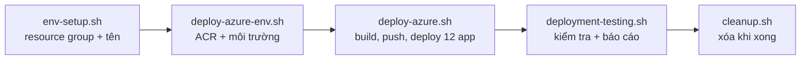

# Lab R2-4 - Azure Cloud Deployment (Container Apps)

**Course:** Advanced Software Development with Agentic AI (ASD 2026)  
**Project:** Digital Banking System - Group 44, Release 2  
**Theme:** Cloud deployment, deployment scripts and CI/CD deployment workflow  
**Primary IDE:** VS Code  
**AI Agent Runtime:** Ollama (qwen2.5:0.5b, llama3.1:8b)  
**Duration:** 120 phút (lần đầu deploy mất 30-45 phút chờ build)  
**Viết cho:** student-5 (Gia), làm lại từ nhánh `main` sạch  
**Dựa trên:** `asd-labs/Lab_11_Testing_Deployment_and_Operations.md`, Section 5 (Azure Deployment) và 6 (CI/CD Deployment)  
**Làm sau:** Lab R2-3  

---

<details>
<summary>Trạng thái kiểm chứng (đọc trước)</summary>

| Phần | Đã kiểm chứng thế nào |
|---|---|
| Proxy nginx 4 frontend | `nginx -t` hợp lệ cả 4; student-5 và student-2 chạy thử qua nginx: trang, `/theme.css`, API đều 200 |
| Đường dẫn tương đối, `theme.css` | Không còn `localhost:820N` hay `localhost:8080/styles.css` trong 4 frontend |
| Sửa `DB_URL` của student-5 | Giả lập biến môi trường cloud: backend dùng đúng `DATABASE_SERVICE_URL`, `/health` = up |
| Các script | `bash -n` không lỗi; `deploy-azure.sh` là bản đã chạy thật trên Azure ngày 21/10, chỉ thêm phần tự đổi tag khi chưa commit |
| Trên Azure (21/10) | student-2 và student-4 **PASS**. student-1 và student-5 FAIL vì 2 lỗi đã sửa trong lab này, **chưa chạy lại** |
| `cloud-deployment.yml` | Cú pháp YAML hợp lệ; **chưa chạy** trên GitHub (cần secrets) |

Không build được Docker image và không vào được Azure từ môi trường viết lab, nên phần Azure bạn là người chạy thật đầu tiên. Gặp lỗi thì xem bảng Troubleshooting ở Section 9.

</details>

## 1. Overview

<details>
<summary>Goal</summary>

Đưa app tích hợp lên **Azure Container Apps** bằng script dùng lại được (tiêu chí 5), bằng GitHub Actions sau khi CI qua (tiêu chí 6), và chứng minh CRUD chạy trên cloud với AI-Mode, MCP, RAG, Multi-Agent **tắt** (tiêu chí 7).

Lab gồm 3 phần:

1. **Sửa code cho cloud:** proxy nginx cho 4 frontend, CSS chung, biến DB của student-5
2. **Script triển khai** (chạy từ Mac)
3. **Workflow `cloud-deployment.yml`**

</details>

<details>
<summary>Deployment Profile</summary>

| Mục | Giá trị | Lý do |
|---|---|---|
| Nền tảng | Azure Container Apps, Consumption | Brief khuyến nghị |
| Subscription | Azure for Students ($100) | |
| Region | `australiaeast` | Nằm trong danh sách vùng trường cho phép |
| Resource group | `clouddeployment-rg` | Gom mọi thứ, `cleanup.sh` xóa một lần |
| Số app | 3 × 4 sinh viên = 12 | student-3 không có service |
| Ingress | database, backend: **internal**; frontend: **external** | Chỉ frontend có link công khai |
| Cờ tính năng | `AI_MODE_ENABLED`, `MCP_ENABLED`, `RAG_ENABLED`, `MULTI_AGENT_ENABLED` = false | Yêu cầu tiêu chí 7 |
| Build image | Docker trên máy, `--platform linux/amd64`, đẩy lên ACR | ACR Tasks bị khóa với Azure for Students |
| Kéo image | Tài khoản admin của ACR | Môi trường "express" không hỗ trợ system-assigned identity |

</details>

<details>
<summary>Deployment Flow</summary>



Đường đi của một request trên cloud:

```
Trình duyệt ──https──► student-N frontend (nginx, external)
                            │  đường dẫn API → ${BACKEND_URL}
                            ▼
                       student-N backend (internal) ──https──► student-N database (internal)
```

</details>

---

## 2. Prerequisites and Configuration

<details>
<summary>Required Tools</summary>

```bash
brew install azure-cli gh
docker buildx version          # Docker Desktop có sẵn buildx
```

</details>

<details>
<summary>One-Time Azure Setup</summary>

```bash
az login                                         # chọn tài khoản @student.uts.edu.au
az account show -o table                         # Name: Azure for Students, State: Enabled
az policy assignment list \
  --query "[?displayName=='Allowed resource deployment regions'].parameters" -o json
#   danh sách phải có australiaeast
az provider register -n Microsoft.App --wait
az provider register -n Microsoft.OperationalInsights --wait
az provider register -n Microsoft.ContainerRegistry --wait
```

</details>

<details>
<summary>Cost Control</summary>

12 app chạy liên tục tốn khoảng **$10–12 mỗi ngày** (ước tính; số thật xem ở portal.azure.com → Education → Available credits). Chỉ deploy khi kiểm tra, chụp ảnh, quay video; xong chạy `cleanup.sh` (Section 7). Mọi thứ tạo lại được từ code.

</details>

---

## 3. Frontend Reverse Proxy

<details>
<summary>Purpose</summary>

Trên cloud, backend là **internal**: trình duyệt không gọi được `http://localhost:8205`. Giải pháp giống Lab 11: trình duyệt chỉ gọi **chính trang frontend**, và nginx trong container frontend chuyển các đường dẫn API sang backend.

Ba việc cho mỗi frontend:

1. `default.conf.template`: nginx proxy theo danh sách đường dẫn API
2. `Dockerfile`: dùng template, đặt `BACKEND_URL` mặc định cho máy local
3. Code: bỏ `http://localhost:820N` để mọi lời gọi thành đường dẫn tương đối

Image nginx chính thức tự thay `${BACKEND_URL}` khi container khởi động (chỉ thay biến có tồn tại, nên `$uri`, `$host`… của nginx giữ nguyên).

</details>

<details>
<summary>Proxy Path Lists</summary>

Danh sách lấy từ route của từng backend. Đường dẫn trùng với file tĩnh thì không được đưa vào (vd student-4 có `users.html`, nhưng regex `^/(users)(/|$)` không khớp `/users.html`).

| Sinh viên | `listen` | Đường dẫn chuyển sang backend | `BACKEND_URL` local |
|---|---|---|---|
| student-1 | 80 | `cards ask ask-with-context pattern-selection architecture-review adr-review students auth mcp rag multi-agent` | `http://student-1-backend:5001` |
| student-2 | 80 | `accounts ask ask-with-context health mcp rag multi-agent` | `http://student2-backend:5001` |
| student-4 | 80 | `users` | `http://student4-backend:5001` |
| student-5 | 8000 | `ui transactions accounts ai mcp rag multi-agent health` | `http://student5-backend:8000` |

Template cũ của student-1 thiếu `cards` (chức năng chính), và Dockerfile cũ không hề dùng template.

</details>

<details>
<summary>student-1/frontend/default.conf.template</summary>

```nginx
# Same-origin proxy: the browser only talks to this frontend, and nginx
# forwards API paths to the student-1 backend. BACKEND_URL is filled in when the
# container starts (the nginx image runs envsubst on /etc/nginx/templates/*):
#   local (Compose): the ENV default in this folder's Dockerfile
#   cloud (Azure):   https://<backend internal FQDN>, set by scripts/clouddeployment/deploy-azure.sh
server {
    listen 80;

    # API routes proxied to the student-1 backend
    location ~ ^/(cards|ask|ask-with-context|pattern-selection|architecture-review|adr-review|students|auth|mcp|rag|multi-agent)(/|$) {
        proxy_pass ${BACKEND_URL};
        proxy_ssl_server_name on;
        proxy_set_header Host $proxy_host;
        proxy_set_header X-Real-IP $remote_addr;
        proxy_set_header X-Forwarded-For $proxy_add_x_forwarded_for;
        proxy_set_header X-Forwarded-Proto $scheme;
        # A multi-agent workflow can take several minutes (Ollama on CPU).
        proxy_read_timeout 900s;
    }

    # Everything else is a static file (pages, tabs, css, js)
    location / {
        root /usr/share/nginx/html;
        index index.html;
        try_files $uri $uri/ /index.html;
    }
}
```

</details>

<details>
<summary>student-1/frontend/dockerfile</summary>

```dockerfile
FROM nginx:alpine

# nginx renders /etc/nginx/templates/*.template into /etc/nginx/conf.d/ when the
# container starts, replacing ${BACKEND_URL}. Remove the default site first.
RUN rm -f /etc/nginx/conf.d/default.conf
COPY default.conf.template /etc/nginx/templates/default.conf.template
COPY *.html /usr/share/nginx/html/
COPY *.css /usr/share/nginx/html/

# Local default: the backend's Compose service name and container port.
# Azure overrides it with the backend Container App's URL.
ENV BACKEND_URL=http://student-1-backend:5001

EXPOSE 80
```

Tên file là `dockerfile` viết thường (giữ nguyên tên). Thêm `COPY *.css` vì trước đây image chỉ chứa `.html`.

</details>

<details>
<summary>student-2/frontend/default.conf.template</summary>

```nginx
# Same-origin proxy: the browser only talks to this frontend, and nginx
# forwards API paths to the student-2 backend. BACKEND_URL is filled in when the
# container starts (the nginx image runs envsubst on /etc/nginx/templates/*):
#   local (Compose): the ENV default in this folder's Dockerfile
#   cloud (Azure):   https://<backend internal FQDN>, set by scripts/clouddeployment/deploy-azure.sh
server {
    listen 80;

    # API routes proxied to the student-2 backend
    location ~ ^/(accounts|ask|ask-with-context|health|mcp|rag|multi-agent)(/|$) {
        proxy_pass ${BACKEND_URL};
        proxy_ssl_server_name on;
        proxy_set_header Host $proxy_host;
        proxy_set_header X-Real-IP $remote_addr;
        proxy_set_header X-Forwarded-For $proxy_add_x_forwarded_for;
        proxy_set_header X-Forwarded-Proto $scheme;
        # A multi-agent workflow can take several minutes (Ollama on CPU).
        proxy_read_timeout 900s;
    }

    # Everything else is a static file (pages, tabs, css, js)
    location / {
        root /usr/share/nginx/html;
        index index.html;
        try_files $uri $uri/ /index.html;
    }
}
```

</details>

<details>
<summary>student-2/frontend/Dockerfile</summary>

```dockerfile
FROM nginx:alpine

# nginx renders /etc/nginx/templates/*.template into /etc/nginx/conf.d/ when the
# container starts, replacing ${BACKEND_URL}. Remove the default site first.
RUN rm -f /etc/nginx/conf.d/default.conf
COPY default.conf.template /etc/nginx/templates/default.conf.template
COPY templates/ /usr/share/nginx/html/
COPY css/ /usr/share/nginx/html/css/

# Local default: the backend's Compose service name and container port.
# Azure overrides it with the backend Container App's URL.
ENV BACKEND_URL=http://student2-backend:5001

EXPOSE 80
```

</details>

<details>
<summary>student-4/frontend/default.conf.template</summary>

```nginx
# Same-origin proxy: the browser only talks to this frontend, and nginx
# forwards API paths to the student-4 backend. BACKEND_URL is filled in when the
# container starts (the nginx image runs envsubst on /etc/nginx/templates/*):
#   local (Compose): the ENV default in this folder's Dockerfile
#   cloud (Azure):   https://<backend internal FQDN>, set by scripts/clouddeployment/deploy-azure.sh
server {
    listen 80;

    # API routes proxied to the student-4 backend
    location ~ ^/(users)(/|$) {
        proxy_pass ${BACKEND_URL};
        proxy_ssl_server_name on;
        proxy_set_header Host $proxy_host;
        proxy_set_header X-Real-IP $remote_addr;
        proxy_set_header X-Forwarded-For $proxy_add_x_forwarded_for;
        proxy_set_header X-Forwarded-Proto $scheme;
        # A multi-agent workflow can take several minutes (Ollama on CPU).
        proxy_read_timeout 900s;
    }

    # Everything else is a static file (pages, tabs, css, js)
    location / {
        root /usr/share/nginx/html;
        index index.html;
        try_files $uri $uri/ /index.html;
    }
}
```

</details>

<details>
<summary>student-4/frontend/Dockerfile</summary>

```dockerfile
FROM nginx:alpine

# nginx renders /etc/nginx/templates/*.template into /etc/nginx/conf.d/ when the
# container starts, replacing ${BACKEND_URL}. Remove the default site first.
RUN rm -f /etc/nginx/conf.d/default.conf
COPY default.conf.template /etc/nginx/templates/default.conf.template
COPY templates/ /usr/share/nginx/html/
COPY css/ /usr/share/nginx/html/css/

# Local default: the backend's Compose service name and container port.
# Azure overrides it with the backend Container App's URL.
ENV BACKEND_URL=http://student4-backend:5001

EXPOSE 80
```

</details>

<details>
<summary>student-5/frontend/default.conf.template</summary>

```nginx
# Same-origin proxy: the browser only talks to this frontend, and nginx
# forwards API paths to the student-5 backend. BACKEND_URL is filled in when the
# container starts (the nginx image runs envsubst on /etc/nginx/templates/*):
#   local (Compose): the ENV default in this folder's Dockerfile
#   cloud (Azure):   https://<backend internal FQDN>, set by scripts/clouddeployment/deploy-azure.sh
server {
    listen 8000;

    # API routes proxied to the student-5 backend
    location ~ ^/(ui|transactions|accounts|ai|mcp|rag|multi-agent|health)(/|$) {
        proxy_pass ${BACKEND_URL};
        proxy_ssl_server_name on;
        proxy_set_header Host $proxy_host;
        proxy_set_header X-Real-IP $remote_addr;
        proxy_set_header X-Forwarded-For $proxy_add_x_forwarded_for;
        proxy_set_header X-Forwarded-Proto $scheme;
        # A multi-agent workflow can take several minutes (Ollama on CPU).
        proxy_read_timeout 900s;
    }

    # Everything else is a static file (pages, tabs, css, js)
    location / {
        root /usr/share/nginx/html;
        index index.html;
        try_files $uri $uri/ /index.html;
    }
}
```

</details>

<details>
<summary>student-5/frontend/Dockerfile</summary>

```dockerfile
FROM nginx:1.27-alpine

# nginx renders /etc/nginx/templates/*.template into /etc/nginx/conf.d/ when the
# container starts, replacing ${BACKEND_URL}. Remove the default site (port 80) first.
RUN rm -f /etc/nginx/conf.d/default.conf
COPY default.conf.template /etc/nginx/templates/default.conf.template
COPY . /usr/share/nginx/html/

# Local default: the backend's Compose service name and container port.
# Azure overrides it with the backend Container App's URL.
ENV BACKEND_URL=http://student5-backend:8000

EXPOSE 8000
```

</details>

<details>
<summary>Remove Hardcoded Backend URLs</summary>

Chạy ở thư mục gốc repo (cú pháp `sed -i ''` của macOS):

```bash
sed -i '' 's#http://localhost:8201##g' student-1/frontend/*.html
sed -i '' 's#http://localhost:8202##g' student-2/frontend/templates/tabs/*.html
sed -i '' 's#http://localhost:8204##g' student-4/frontend/templates/js/utils.js
sed -i '' 's#http://localhost:8205##g' student-5/frontend/tabs/*.html

grep -rnE "localhost:82[0-9]{2}" student-*/frontend      # không in gì = xong
```

Ví dụ kết quả: `const apiBase = "http://localhost:8205";` → `const apiBase = "";`, `hx-get="http://localhost:8205/ui/transactions"` → `hx-get="/ui/transactions"`. Đường dẫn bắt đầu bằng `/` nên trong iframe `tabs/…` vẫn gọi về gốc trang.

Dòng ghi chú `// const apiBase = "http://localhost:5001";` trong `cm_multiagent.html` là comment, không ảnh hưởng.

</details>

<details>
<summary>Shared Theme (theme.css)</summary>

Mọi trang lấy CSS chung từ `http://localhost:8080/styles.css` (container `shared-index`). Trên cloud không có địa chỉ này nên trang mất màu. Mỗi frontend tự mang một bản sao tên `theme.css`:

```bash
cp shared/frontend/styles.css student-1/frontend/theme.css
cp shared/frontend/styles.css student-2/frontend/templates/theme.css
cp shared/frontend/styles.css student-4/frontend/templates/theme.css
cp shared/frontend/styles.css student-5/frontend/theme.css

grep -rlE 'http://localhost:8080/styles.css' student-*/frontend \
  | xargs sed -i '' 's#http://localhost:8080/styles.css#/theme.css#g'

grep -rn "localhost:8080/styles.css" student-*/frontend   # không in gì = xong (21 file đã đổi)
```

Vị trí khác nhau vì mỗi Dockerfile copy một thư mục khác vào web server. Sửa `shared/frontend/styles.css` sau này thì chạy lại 4 lệnh `cp`. Nút "← Dashboard" vẫn trỏ `localhost:8080`, nên trên cloud không bấm được (chỉ là điều hướng, không ảnh hưởng tiêu chí).

</details>

<details>
<summary>Test Locally</summary>

```bash
docker compose up -d --build
curl -s localhost:8105/health                          # student-5: JSON từ backend, qua nginx
curl -s "localhost:8105/transactions?limit=1" | head -c 120; echo
curl -s localhost:8102/accounts | head -c 120; echo    # student-2
curl -s localhost:8104/users | head -c 120; echo       # student-4
curl -s "localhost:8101/cards/by-id?card_id=1"         # student-1 (trả HTML)
curl -s -o /dev/null -w "%{http_code} %{content_type}\n" localhost:8105/theme.css     # 200 text/css
```

Mở 8101, 8102, 8104, 8105 trên trình duyệt: có màu như cũ, các nút hoạt động.

</details>

---

## 4. Backend Configuration for the Cloud (student-5)

<details>
<summary>Why student-5 Returned 500 on Azure</summary>

`student-5/backend/Dockerfile` có sẵn `ENV DB_URL=http://student5-db:8000`. Tên `student5-db` chỉ tồn tại trong Docker Compose. Script deploy truyền địa chỉ đúng qua `DATABASE_SERVICE_URL`, nhưng code ưu tiên `DB_URL`, nên trên Azure backend gọi một địa chỉ không tồn tại → lỗi kết nối → 500.

Student-2 và student-4 không bị vì code của họ chỉ đọc `DATABASE_SERVICE_URL`.

</details>

<details>
<summary>student-5/backend/services/database_api.py</summary>

Tìm dòng:

```python
DB_URL = os.environ.get("DB_URL", "http://localhost:8305")
```

Thay bằng:

```python
# Cloud (deploy-azure.sh) sets DATABASE_SERVICE_URL. Compose and the backend Dockerfile
# set DB_URL=http://student5-db:8000, a name that only exists inside Docker Compose,
# so the cloud value must win.
DB_URL = os.environ.get("DATABASE_SERVICE_URL") or os.environ.get("DB_URL", "http://localhost:8305")
```

| Chạy ở | Biến có | Dùng |
|---|---|---|
| Máy (Compose) | `DB_URL` | `http://student5-db:8000` |
| Azure | cả hai | `DATABASE_SERVICE_URL` (địa chỉ DB trên Azure) |

Dockerfile backend còn `ACCOUNTS_URL=http://student2-database:5002`. Trên cloud, backend không gọi được dịch vụ Accounts, nhưng `REQUIRE_ACCOUNTS` mặc định `false` nên nạp/rút/chuyển tiền vẫn chạy (bỏ qua bước kiểm tra tài khoản).

</details>

<details>
<summary>student-5.yml - check the proxy in CI</summary>

Trong bước `Smoke checks`, thêm một dòng sau `check_url "http://localhost:8105/"`:

```bash
          check_url "http://localhost:8105/"
          check_url "http://localhost:8105/health"   # frontend nginx -> backend proxy
```

CI giờ chứng minh được cả đường frontend → nginx → backend → database.

</details>

<details>
<summary>Commit (code changes)</summary>

```bash
pytest student-5/tests -q --ignore=student-5/tests/post_commit --ignore=student-5/tests/pre_commit   # 94 passed
git add student-1/frontend student-2/frontend student-4/frontend student-5/frontend \
        student-5/backend/services/database_api.py .github/workflows/student-5.yml
git commit -m "Cloud-ready frontends: nginx same-origin proxy, relative URLs, bundled theme; student-5 prefers DATABASE_SERVICE_URL"
```

</details>

---

## 5. Azure Deployment Scripts

<details>
<summary>Script Files</summary>

| File | Trạng thái |
|---|---|
| `scripts/clouddeployment/gh-secrets-setup.sh` | giữ nguyên (trên `main`) |
| `scripts/clouddeployment/env-setup.sh` | giữ nguyên |
| `scripts/clouddeployment/deploy-azure-env.sh` | giữ nguyên |
| `scripts/clouddeployment/deploy-azure.sh` | **thay toàn bộ** |
| `scripts/clouddeployment/deployment-testing.sh` | **thay toàn bộ** (bản trên `main` là bản copy Lab 11) |
| `scripts/clouddeployment/cleanup.sh` | giữ nguyên |

Bốn file giữ nguyên đã có trên `main`; Section 6 giải thích từng script làm gì. Kiểm tra chúng đúng là bản trên `main`:

```bash
git diff origin/main -- scripts/clouddeployment/env-setup.sh scripts/clouddeployment/deploy-azure-env.sh scripts/clouddeployment/cleanup.sh scripts/clouddeployment/gh-secrets-setup.sh   # không in gì
```

</details>

<details>
<summary>scripts/clouddeployment/deploy-azure.sh</summary>

```bash
#!/bin/bash
set -e

# Builds and deploys the frontend, backend and database of every student in STUDENTS
# (default: student-1 student-2 student-4 student-5 = 12 apps) to an existing
# Container Apps environment.
# Run scripts/clouddeployment/env-setup.sh and deploy-azure-env.sh first.
#
# Per student, from <repo-root>/<student>/{frontend,backend,database}/Dockerfile:
#   database -> internal ingress only
#   backend  -> internal ingress only, given the database URL
#   frontend -> external ingress (the only public-facing app), given the backend URL
#
# MCP, RAG and multi-agent servers are NOT built or deployed. Re-running the script
# updates apps that already exist.
#
# Azure for Students constraints this script works around:
#   - ACR Tasks ('az acr build') is blocked (TasksOperationsNotAllowed), so images are
#     built with the local Docker and pushed to the registry.
#   - The Container Apps environment is an "express" environment, which does not support
#     a system-assigned identity, so apps pull images with the registry's admin login.

echo "=== Cloud Azure Deployment ==="

RESOURCE_GROUP="${RESOURCE_GROUP:-clouddeployment-rg}"
STUDENTS="${STUDENTS:-student-1 student-2 student-4 student-5}"
REPO_ROOT="$(cd "$(dirname "${BASH_SOURCE[0]}")/../.." && pwd)"

# The image tag is the commit id, so every commit deploys a new revision. With
# uncommitted changes the tag also gets a timestamp; otherwise Azure would see the
# same image name and keep running the old container.
if [[ -z "${IMAGE_TAG:-}" ]]; then
    IMAGE_TAG="$(git -C "$REPO_ROOT" rev-parse --short HEAD 2>/dev/null || echo latest)"
    if [[ -n "$(git -C "$REPO_ROOT" status --porcelain 2>/dev/null)" ]]; then
        IMAGE_TAG="${IMAGE_TAG}-dirty-$(date +%Y%m%d%H%M%S)"
        echo "Uncommitted changes found: using image tag $IMAGE_TAG"
    fi
fi

tag() { az group show --name "$RESOURCE_GROUP" --query "tags.\"$1\"" -o tsv 2>/dev/null || true; }

# Accepts both "Dockerfile" and "dockerfile", and returns the file's REAL name.
# macOS is case-insensitive, so [[ -f Dockerfile ]] is also true for "dockerfile",
# but Linux (the containers, GitHub Actions) is case-sensitive.
find_dockerfile() { # <student> <service>
    local dir="$REPO_ROOT/$1/$2" f
    f=$(find "$dir" -maxdepth 1 -type f \( -name Dockerfile -o -name dockerfile \) 2>/dev/null | head -n1)
    if [[ -n "$f" ]]; then echo "$f"; return 0; fi
    return 1
}

# Build context for a service. Usually its own folder, but student-2's backend
# Dockerfile copies both backend/ and prompts/, so docker-compose.yml builds it
# from student-2/ (context: ./student-2, dockerfile: backend/dockerfile).
build_context() { # <student> <service>
    if [[ "$1" == "student-2" && "$2" == "backend" ]]; then
        echo "$REPO_ROOT/$1"
    else
        echo "$REPO_ROOT/$1/$2"
    fi
}

# Port comes from <STUDENT>_<SERVICE>_PORT (e.g. STUDENT_1_BACKEND_PORT) if set,
# otherwise from the first EXPOSE line of that service's Dockerfile. Nothing is assumed.
get_port() { # <student> <service> <dockerfile>
    local var
    var="$(echo "${1}_${2}_PORT" | tr 'a-z-' 'A-Z_')"
    if [[ -n "${!var:-}" ]]; then echo "${!var}"; return 0; fi
    grep -iE '^[[:space:]]*EXPOSE[[:space:]]' "$3" | head -n1 | grep -oE '[0-9]+' | head -n1 || true
}

# Step 1: Read deployment names from resource group tags
REGISTRY_NAME=$(tag registryName)
ENV_NAME=$(tag envName)

if [[ -z "$REGISTRY_NAME" || -z "$ENV_NAME" ]]; then
    echo "Resource group $RESOURCE_GROUP is missing deployment tags. Run scripts/clouddeployment/env-setup.sh first." >&2
    exit 1
fi

REGISTRY_SERVER=$(az acr show --name "$REGISTRY_NAME" --resource-group "$RESOURCE_GROUP" --query loginServer -o tsv)

# Step 2: Registry access
# Docker on this machine pushes the images; the Container Apps pull them with the
# registry's admin login (express environments cannot use a system-assigned identity).
az acr login --name "$REGISTRY_NAME"
az acr update --name "$REGISTRY_NAME" --admin-enabled true -o none
REGISTRY_USER=$(az acr credential show --name "$REGISTRY_NAME" --query username -o tsv)
REGISTRY_PASS=$(az acr credential show --name "$REGISTRY_NAME" --query "passwords[0].value" -o tsv)

# Step 3: Validate every student before building anything (fail fast)
for S in $STUDENTS; do
    for SVC in frontend backend database; do
        DF=$(find_dockerfile "$S" "$SVC") || { echo "Missing Dockerfile: $S/$SVC" >&2; exit 1; }
        [[ -n "$(get_port "$S" "$SVC" "$DF")" ]] || { echo "No port for $S/$SVC: add an EXPOSE line to its Dockerfile or set $(echo "${S}_${SVC}_PORT" | tr 'a-z-' 'A-Z_')." >&2; exit 1; }
        [[ -n "$(tag "$S-$SVC")" ]] || { echo "No app name tag for $S-$SVC. Run scripts/clouddeployment/env-setup.sh first." >&2; exit 1; }
    done
done

deploy_app() { # <app> <image> <port> <ingress> <cpu> <memory> <min> <max> [KEY=VALUE ...]
    local app=$1 image=$2 port=$3 ingress=$4 cpu=$5 mem=$6 min=$7 max=$8
    shift 8
    if az containerapp show --name "$app" --resource-group "$RESOURCE_GROUP" -o none 2>/dev/null; then
        echo "Updating $app..."
        local setargs=()
        if [[ $# -gt 0 ]]; then setargs=(--set-env-vars "$@"); fi
        az containerapp update \
            --name "$app" \
            --resource-group "$RESOURCE_GROUP" \
            --image "$image" \
            --cpu "$cpu" --memory "$mem" \
            --min-replicas "$min" --max-replicas "$max" \
            ${setargs[@]+"${setargs[@]}"}
    else
        echo "Creating $app..."
        local envargs=()
        if [[ $# -gt 0 ]]; then envargs=(--env-vars "$@"); fi
        az containerapp create \
            --name "$app" \
            --resource-group "$RESOURCE_GROUP" \
            --environment "$ENV_NAME" \
            --image "$image" \
            --target-port "$port" \
            --ingress "$ingress" \
            --registry-server "$REGISTRY_SERVER" \
            --registry-username "$REGISTRY_USER" \
            --registry-password "$REGISTRY_PASS" \
            --cpu "$cpu" --memory "$mem" \
            --min-replicas "$min" --max-replicas "$max" \
            ${envargs[@]+"${envargs[@]}"}
    fi
}

app_fqdn() {
    az containerapp show --name "$1" --resource-group "$RESOURCE_GROUP" \
        --query properties.configuration.ingress.fqdn -o tsv
}

SUMMARY=""

for S in $STUDENTS; do
    echo ""
    echo "##### $S #####"

    DB_APP_NAME=$(tag "$S-database")
    BACKEND_APP_NAME=$(tag "$S-backend")
    FRONTEND_APP_NAME=$(tag "$S-frontend")

    # Step 4: Build the 3 images with local Docker and push them to the registry.
    # --platform linux/amd64: Azure runs amd64; Apple Silicon Macs build arm64 by default.
    for SVC in database backend frontend; do
        DF=$(find_dockerfile "$S" "$SVC")
        echo "Building $S/$SVC:$IMAGE_TAG..."
        docker buildx build \
            --platform linux/amd64 \
            --file "$DF" \
            --tag "${REGISTRY_SERVER}/$S/$SVC:$IMAGE_TAG" \
            --push \
            "$(build_context "$S" "$SVC")"
    done

    # Step 5: Database (internal only, no public access)
    echo "Deploying $S database..."
    deploy_app "$DB_APP_NAME" "${REGISTRY_SERVER}/$S/database:${IMAGE_TAG}" \
        "$(get_port "$S" database "$(find_dockerfile "$S" database)")" internal 0.5 1.0Gi 1 1
    DB_FQDN=$(app_fqdn "$DB_APP_NAME")

    # Step 6: Backend (internal only, talks to this student's database)
    # The AI-feature flags are explicitly disabled: no AI-Mode, MCP, RAG or multi-agent in the cloud.
    echo "Deploying $S backend..."
    deploy_app "$BACKEND_APP_NAME" "${REGISTRY_SERVER}/$S/backend:${IMAGE_TAG}" \
        "$(get_port "$S" backend "$(find_dockerfile "$S" backend)")" internal 0.5 1.0Gi 1 3 \
        DATABASE_SERVICE_URL="https://$DB_FQDN" \
        AI_MODE_ENABLED=false MCP_ENABLED=false RAG_ENABLED=false MULTI_AGENT_ENABLED=false
    BACKEND_FQDN=$(app_fqdn "$BACKEND_APP_NAME")

    # Step 7: Frontend (the only public-facing app). Its nginx proxies API paths to BACKEND_URL.
    echo "Deploying $S frontend..."
    deploy_app "$FRONTEND_APP_NAME" "${REGISTRY_SERVER}/$S/frontend:${IMAGE_TAG}" \
        "$(get_port "$S" frontend "$(find_dockerfile "$S" frontend)")" external 0.25 0.5Gi 1 3 \
        BACKEND_URL="https://$BACKEND_FQDN"
    FRONTEND_FQDN=$(app_fqdn "$FRONTEND_APP_NAME")

    SUMMARY+="  $S frontend: https://$FRONTEND_FQDN"$'\n'
done

echo ""
echo "=== Deployment Complete ==="
printf '%s' "$SUMMARY"
echo ""
echo "Validate with: bash scripts/clouddeployment/deployment-testing.sh"
```

**Giải thích - 6 chỗ khác bản của Juno, mỗi chỗ là một lỗi đã gặp thật:**

| Chỗ | Lỗi đã gặp | Cách xử lý |
|---|---|---|
| `IMAGE_TAG` thêm `-dirty-<giờ>` khi còn thay đổi chưa commit | Sửa code, deploy lại, mà Azure vẫn chạy bản cũ (tag giống nhau nên không có revision mới) | Tag luôn mới khi code chưa commit |
| `find_dockerfile` dùng `find -name` | `Unable to find 'Dockerfile'`: macOS không phân biệt hoa thường, Linux thì có | Trả về đúng tên thật của file |
| `build_context` | `"/prompts": not found` khi build backend student-2 | Backend student-2 build từ thư mục `student-2/`, như trong `docker-compose.yml` |
| `az acr login` + `docker buildx build --platform linux/amd64 --push` | `TasksOperationsNotAllowed` (ACR Tasks bị khóa với Azure for Students) | Build trên máy rồi đẩy lên; `amd64` vì Mac chip M build `arm64` |
| `az acr update --admin-enabled true` + `--registry-username/--registry-password` | `ExpressEnvironmentFeatureNotSupported ... identity` | Môi trường express không cho system-assigned identity, nên kéo image bằng tài khoản admin. Mật khẩu được Azure lưu thành secret của app, không in ra, không vào git |
| Biến cho frontend là `BACKEND_URL` | Bản cũ đặt `BACKEND_SERVICE_URL`, nginx không đọc | Khớp với template |

</details>

<details>
<summary>scripts/clouddeployment/deployment-testing.sh</summary>

```bash
#!/bin/bash
set -e

# Validates the integrated cloud deployment for every student in STUDENTS and
# writes docs/cloud-deployment/deployment-results.md (evidence for the report).
# Run after scripts/clouddeployment/deploy-azure.sh.
#
# Per student it checks, through the PUBLIC frontend URL only:
#   1. the frontend page loads                          -> expect 200
#   2. one read endpoint, proxied by nginx to backend   -> expect 200 (frontend -> backend -> database)
#   3. the Multi-Agent route is not available in cloud  -> expect 403 (switched off), or 404/405 (no route)

RESOURCE_GROUP="${RESOURCE_GROUP:-clouddeployment-rg}"
STUDENTS="${STUDENTS:-student-1 student-2 student-4 student-5}"
REPORT_DIR="${REPORT_DIR:-docs/cloud-deployment}"
REPORT_FILE="$REPORT_DIR/deployment-results.md"

# One read-only API path per student, served by that student's backend.
api_path() {
    case "$1" in
        student-1) echo "/cards/by-id?card_id=1" ;;
        student-2) echo "/accounts" ;;
        student-4) echo "/users" ;;
        student-5) echo "/transactions?limit=5" ;;
        *)         echo "/" ;;
    esac
}

tag() { az group show --name "$RESOURCE_GROUP" --query "tags.\"$1\"" -o tsv 2>/dev/null || true; }

# curl with retries: a Container App may still be starting.
http_code() { # <method> <url>
    local code=""
    for _ in 1 2 3 4 5 6; do
        code=$(curl -s -o /dev/null -w "%{http_code}" -X "$1" --max-time 30 "$2" || true)
        if [[ "$code" != "000" && "$code" != "502" && "$code" != "503" && "$code" != "504" ]]; then
            break
        fi
        sleep 10
    done
    echo "${code:-000}"
}

echo "=== Cloud Deployment Testing ==="
mkdir -p "$REPORT_DIR"

ROWS=""
FAILED=0

for S in $STUDENTS; do
    APP_NAME=$(tag "$S-frontend")
    if [[ -z "$APP_NAME" ]]; then
        echo "No frontend tag for $S. Run env-setup.sh and deploy-azure.sh first." >&2
        exit 1
    fi
    FQDN=$(az containerapp show --name "$APP_NAME" --resource-group "$RESOURCE_GROUP" \
        --query properties.configuration.ingress.fqdn -o tsv)
    URL="https://$FQDN"
    API="$(api_path "$S")"

    PAGE=$(http_code GET "$URL/")
    READ=$(http_code GET "$URL$API")
    MA=$(http_code POST "$URL/multi-agent/workflow")

    RESULT="PASS"
    [[ "$PAGE" == "200" ]] || RESULT="FAIL"
    [[ "$READ" == "200" ]] || RESULT="FAIL"
    [[ "$MA" == "403" || "$MA" == "404" || "$MA" == "405" ]] || RESULT="FAIL"
    [[ "$RESULT" == "PASS" ]] || FAILED=1

    echo "$S  page=$PAGE  read($API)=$READ  multi-agent=$MA  -> $RESULT"
    ROWS+="| $S | $URL | $PAGE | \`$API\` $READ | $MA | $RESULT |"$'\n'
done

cat > "$REPORT_FILE" <<REPORT
# Cloud Deployment Report

Platform: Azure Container Apps
Resource group: $RESOURCE_GROUP
Commit: $(git rev-parse --short HEAD 2>/dev/null || echo unknown)
Timestamp: $(date -u +%Y-%m-%dT%H:%M:%SZ)

| Student | Frontend URL | Page | Read endpoint (via frontend proxy) | Multi-Agent (expect 403/404/405) | Result |
|---|---|---|---|---|---|
$ROWS
Overall: $([[ $FAILED -eq 0 ]] && echo "Success" || echo "Failed")

AI-Mode, MCP, RAG and Multi-Agent are disabled in this deployment
(MCP_ENABLED, RAG_ENABLED, MULTI_AGENT_ENABLED = false on every backend).
REPORT

echo ""
cat "$REPORT_FILE"
echo "=== Deployment Testing Complete ==="
exit $FAILED
```

**Giải thích:** với mỗi sinh viên, qua **link công khai** của frontend:

| Kiểm tra | Mong đợi |
|---|---|
| Trang chính | 200 |
| Một API đọc qua proxy: student-1 `/cards/by-id?card_id=1`, student-2 `/accounts`, student-4 `/users`, student-5 `/transactions?limit=5` | 200 (frontend → backend → database) |
| `POST /multi-agent/workflow` | 403 (tắt), hoặc 404/405 nếu sinh viên đó không có route |

`http_code` thử lại 6 lần, cách 10 giây, vì app vừa tạo có thể chưa sẵn sàng. Kết quả ghi vào `docs/cloud-deployment/deployment-results.md`; có dòng FAIL thì script thoát với mã lỗi.

Student-1 kiểm tra `/cards/by-id` vì `GET /cards` (lấy cả danh sách) có lỗi sẵn trong code (gọi `.json()` trên một list) và giao diện không dùng nó. Báo Juno để sửa.

</details>

---

## 6. Run the Deployment

<details>
<summary>Step 0: Commit First</summary>

```bash
git status          # phải sạch
```

Tag image là mã commit. Script tự thêm `-dirty-<giờ>` nếu còn thay đổi, nhưng commit trước thì tag gọn và khớp với lịch sử.

</details>

<details>
<summary>Step 1: env-setup.sh</summary>

```bash
export RESOURCE_GROUP=clouddeployment-rg
export LOCATION=australiaeast
bash scripts/clouddeployment/env-setup.sh
```

Tạo resource group và **đặt sẵn tên** cho registry, môi trường và 12 app, lưu thành tag của resource group. Chạy lại thì dùng lại tên cũ (`already configured — reusing existing names`).

</details>

<details>
<summary>Step 2: deploy-azure-env.sh</summary>

```bash
bash scripts/clouddeployment/deploy-azure-env.sh
```

Tạo Azure Container Registry (Basic) và môi trường Container Apps. Mong đợi `"provisioningState": "Succeeded"` rồi `=== Container Apps Environment Ready ===`. Dòng `No Log Analytics workspace provided` là thông báo bình thường.

</details>

<details>
<summary>Step 3: deploy-azure.sh</summary>

Mở Docker Desktop trước, rồi:

```bash
bash scripts/clouddeployment/deploy-azure.sh 2>&1 | tee ~/deploy-log.txt
```

Mong đợi theo thứ tự:

```
=== Cloud Azure Deployment ===
Login Succeeded

##### student-1 #####
Building student-1/database:<tag>...
#… [+] Building … pushing manifest … done
Deploying student-1 database...
Creating student-1-database-NNNNN...      (lần sau: Updating …)
Deploying student-1 backend...
Deploying student-1 frontend...
… student-2, student-4, student-5 …

=== Deployment Complete ===
  student-1 frontend: https://student-1-frontend-NNNNN.<env>.australiaeast.azurecontainerapps.io
  student-2 frontend: https://…
  student-4 frontend: https://…
  student-5 frontend: https://…
```

Lần đầu 30–45 phút (build `amd64` trên Mac chip M chạy qua giả lập). Lần sau nhanh hơn nhiều nhờ cache.

</details>

<details>
<summary>Step 4: deployment-testing.sh</summary>

```bash
bash scripts/clouddeployment/deployment-testing.sh
```

Mong đợi:

```
=== Cloud Deployment Testing ===
student-1  page=200  read(/cards/by-id?card_id=1)=200  multi-agent=403  -> PASS
student-2  page=200  read(/accounts)=200  multi-agent=404  -> PASS
student-4  page=200  read(/users)=200  multi-agent=405  -> PASS
student-5  page=200  read(/transactions?limit=5)=200  multi-agent=403  -> PASS
```

Kết quả ngày 21/10 (trước 2 sửa lỗi của lab này): student-2, student-4 PASS; student-1, student-5 read = 500.

</details>

<details>
<summary>Step 5: Manual Check and Evidence</summary>

Mở link student-5 trên trình duyệt:

| Thao tác | Tab | Mong đợi |
|---|---|---|
| Xem danh sách giao dịch | Normal | có dữ liệu, có màu |
| Nạp, rút, chuyển tiền | Normal | giao dịch mới hiện ra |
| Xóa một giao dịch | Normal | biến mất khỏi danh sách |
| Mở AI / MCP / RAG / Multi-Agent | các tab còn lại | báo tắt (403) |

Chụp ảnh có **thanh địa chỉ hiện link Azure**. Lưu báo cáo:

```bash
git add docs/cloud-deployment/deployment-results.md
git commit -m "Cloud deployment report"
```

Dữ liệu SQLite nằm trong container: mỗi lần container khởi động lại, dữ liệu quay về dữ liệu mẫu. Ghi điều này vào phần Known Issues của báo cáo.

</details>

---

## 7. Cleanup

<details>
<summary>cleanup.sh</summary>

```bash
bash scripts/clouddeployment/cleanup.sh          # gõ clouddeployment-rg để xác nhận
```

Xóa cả resource group (12 app, registry, môi trường) ở chế độ nền. Khi cần demo lại: chạy lại Step 1 → 4.

</details>

---

## 8. CI/CD Deployment

<details>
<summary>.github/workflows/cloud-deployment.yml</summary>

```yaml
# Cloud deployment - Azure Container Apps
# Deploys the integrated application (frontend, backend, database of every
# student in STUDENTS) after the required student CI/CD workflows have passed.
# AI-Mode, MCP, RAG and Multi-Agent stay disabled (deploy-azure.sh sets the flags).
#
# Run it: GitHub -> Actions -> cloud-deployment -> Run workflow.
# Needs the AZURE_CLIENT_ID, AZURE_TENANT_ID and AZURE_SUBSCRIPTION_ID secrets
# (created once by scripts/clouddeployment/gh-secrets-setup.sh).

name: cloud-deployment

on:
  workflow_dispatch:
    inputs:
      students:
        description: "Students to deploy"
        default: "student-1 student-2 student-4 student-5"

permissions:
  id-token: write   # Azure login with OIDC
  contents: read
  actions: read     # read the student workflow results in the CI gate

env:
  RESOURCE_GROUP: clouddeployment-rg
  LOCATION: australiaeast
  STUDENTS: ${{ github.event.inputs.students || 'student-1 student-2 student-4 student-5' }}
  # Workflows that must have passed on this branch before anything is deployed.
  # student-3.yml and student-4.yml are empty, so they cannot be required yet.
  REQUIRED_WORKFLOWS: "student-1.yml student-2.yml student-5.yml"

jobs:
  # 1. Gate: the latest run of every required student workflow on this branch succeeded
  ci-gate:
    name: Required CI/CD validation
    runs-on: ubuntu-latest
    steps:
      - name: Check student workflow results
        env:
          GH_TOKEN: ${{ github.token }}
        run: |
          failed=0
          for wf in $REQUIRED_WORKFLOWS; do
            result=$(gh run list --repo "${{ github.repository }}" --workflow "$wf" \
                       --branch "${{ github.ref_name }}" --limit 1 \
                       --json conclusion,headSha,url \
                       -q '.[0] | "\(.conclusion) \(.headSha[0:7]) \(.url)"' || true)
            echo "$wf -> ${result:-no run on ${{ github.ref_name }}}"
            [[ "$result" == success* ]] || failed=1
          done
          if [[ $failed -ne 0 ]]; then
            echo "A required workflow has not passed. Fix it before deploying."
          fi
          exit $failed

  # 2. Deploy with the reusable scripts, then validate and keep the evidence
  deploy-azure:
    name: Deploy to Azure Container Apps
    runs-on: ubuntu-latest
    needs: [ci-gate]
    steps:
      - uses: actions/checkout@v4

      - name: Azure login
        uses: azure/login@v2
        with:
          client-id: ${{ secrets.AZURE_CLIENT_ID }}
          tenant-id: ${{ secrets.AZURE_TENANT_ID }}
          subscription-id: ${{ secrets.AZURE_SUBSCRIPTION_ID }}

      - name: Resource group and deployment names
        run: bash scripts/clouddeployment/env-setup.sh

      - name: Azure login (refresh)
        uses: azure/login@v2
        with:
          client-id: ${{ secrets.AZURE_CLIENT_ID }}
          tenant-id: ${{ secrets.AZURE_TENANT_ID }}
          subscription-id: ${{ secrets.AZURE_SUBSCRIPTION_ID }}

      - name: Container registry and Container Apps environment
        run: bash scripts/clouddeployment/deploy-azure-env.sh

      - name: Azure login (refresh again)
        uses: azure/login@v2
        with:
          client-id: ${{ secrets.AZURE_CLIENT_ID }}
          tenant-id: ${{ secrets.AZURE_TENANT_ID }}
          subscription-id: ${{ secrets.AZURE_SUBSCRIPTION_ID }}

      - name: Build images and deploy every student's services
        run: bash scripts/clouddeployment/deploy-azure.sh

      - name: Azure login (refresh before testing)
        uses: azure/login@v2
        with:
          client-id: ${{ secrets.AZURE_CLIENT_ID }}
          tenant-id: ${{ secrets.AZURE_TENANT_ID }}
          subscription-id: ${{ secrets.AZURE_SUBSCRIPTION_ID }}

      - name: Validate deployment and write the report
        run: bash scripts/clouddeployment/deployment-testing.sh

      - name: Upload deployment evidence
        if: always()
        uses: actions/upload-artifact@v4
        with:
          name: azure-deployment-evidence
          path: docs/cloud-deployment/
```

**Giải thích:**

| Job | Làm gì |
|---|---|
| `ci-gate` | Dùng `gh run list` xem lần chạy mới nhất của `student-1.yml`, `student-2.yml`, `student-5.yml` **trên cùng nhánh** có `success` không. Có cái nào chưa xanh thì dừng: đây là yêu cầu "after the required CI/CD validation succeeds" của tiêu chí 6 |
| `deploy-azure` | Đăng nhập Azure bằng OIDC → chạy đúng 4 script ở Section 6 → upload artifact `azure-deployment-evidence` |

Đăng nhập lại (`refresh`) trước mỗi script dài, theo Lab 11 ("Why two refreshes"): token OIDC hết hạn nhanh. Máy chạy GitHub là `linux/amd64` và có Docker, nên `docker buildx … --push` trong `deploy-azure.sh` chạy được, không cần ACR Tasks.

`student-3.yml`, `student-4.yml` đang rỗng nên chưa thể bắt buộc trong cổng.

</details>

<details>
<summary>GitHub Secrets (one time)</summary>

```bash
git switch main && git pull
bash scripts/clouddeployment/gh-secrets-setup.sh
```

Script tạo app registration `cloud-dev-github-oidc`, gán quyền Contributor và User Access Administrator trên subscription, rồi lưu `AZURE_CLIENT_ID`, `AZURE_TENANT_ID`, `AZURE_SUBSCRIPTION_ID` vào GitHub.

| Lưu ý | Vì sao |
|---|---|
| Cần quyền **admin** của repo `JE-Wardrop/project-ASD` | Chỉ admin đặt được secrets; nếu bạn không có, nhờ Juno chạy hoặc cấp quyền |
| Chạy trên **`main`** | Script gắn quyền đăng nhập với **nhánh đang đứng**; workflow chỉ đăng nhập được từ nhánh đó |
| Subscription của người chạy sẽ trả tiền | Dùng tài khoản đã làm Section 2 |

</details>

<details>
<summary>Trigger and Monitor</summary>

1. Merge `release2-gia` vào `main` (Pull Request), chờ `student-1`, `student-2`, `student-5` xanh trên `main`
2. GitHub → **Actions** → **cloud-deployment** → **Run workflow** (nhánh `main`)
3. Job `ci-gate` in kết quả từng workflow, rồi `deploy-azure` chạy 4 script
4. Tải artifact **azure-deployment-evidence** (`deployment-results.md`)
5. Chụp màn hình run xanh (bằng chứng tiêu chí 6)
6. Chạy `cleanup.sh` trên máy khi xong

</details>

---

## 9. Troubleshooting

<details>
<summary>Errors Seen on 19-21 Oct and Their Fixes</summary>

| Triệu chứng | Nguyên nhân | Đã xử lý ở |
|---|---|---|
| `ERROR: Unable to find 'Dockerfile'` | macOS không phân biệt hoa thường | `find_dockerfile` |
| `ERROR: Unable to find 'dockerfile'` | `az acr build --file` tính từ thư mục hiện tại | bỏ `az acr build` |
| `TasksOperationsNotAllowed` | ACR Tasks bị khóa với Azure for Students | `docker buildx --push` |
| `ExpressEnvironmentFeatureNotSupported ... registries[].identity` | Môi trường express | tài khoản admin của ACR |
| Cùng lỗi trên nhưng dòng là "Updating …" | App tạo dở từ lần lỗi trước vẫn mang identity | `az containerapp delete -n <tên app> -g clouddeployment-rg --yes`, chạy lại |
| `"/prompts": not found` (backend student-2) | Sai build context | `build_context` |
| student-5 read = 500 | `DB_URL` nướng sẵn trong Dockerfile | Section 4 |
| student-1 read = 500 trên `/cards` | Lỗi sẵn trong code `GET /cards` | kiểm tra `/cards/by-id` |
| Trang không có màu | CSS từ `localhost:8080` | `theme.css` |
| Sửa xong deploy lại mà không đổi | Tag image không đổi | tag `-dirty-<giờ>` / commit trước |
| `az acr login` báo lỗi docker daemon | Docker Desktop chưa chạy xong | mở Docker Desktop, chờ "Engine running" |

Xem log bên trong một app:

```bash
az containerapp logs show -n <tên app> -g clouddeployment-rg --tail 30
az group show -n clouddeployment-rg --query tags -o json        # tên 12 app
```

</details>

---

## 10. Evidence Checklist

<details>
<summary>Record Evidence</summary>

| Tiêu chí | Bằng chứng |
|---|---|
| 5 | `~/deploy-log.txt` (cắt đoạn đầu, đoạn cuối), 4 script trong repo |
| 6 | Ảnh run `cloud-deployment` xanh + artifact `azure-deployment-evidence` |
| 7 | `docs/cloud-deployment/deployment-results.md` 4 dòng PASS + ảnh từng link Azure với một thao tác CRUD + ảnh tab bị tắt |

</details>
